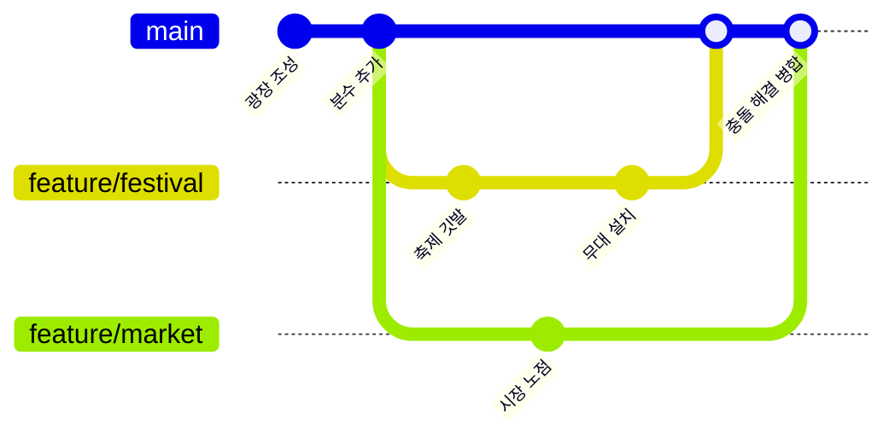
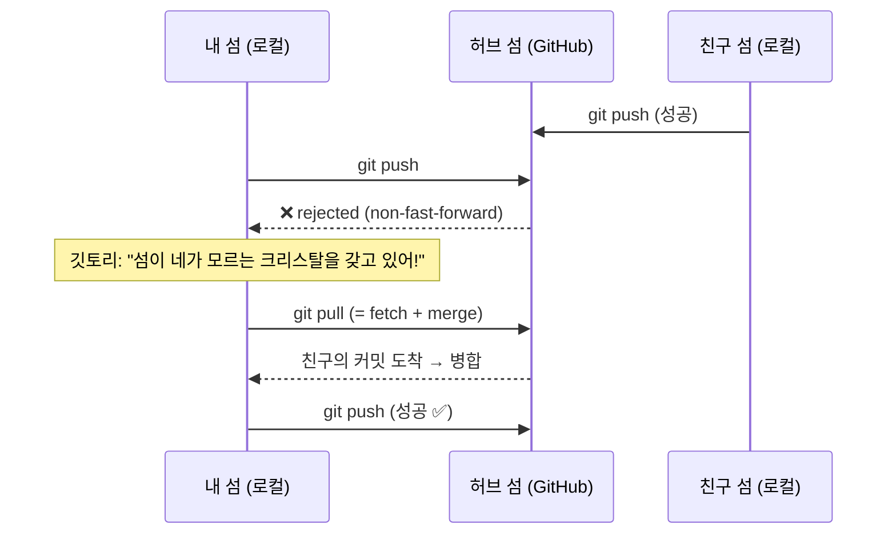
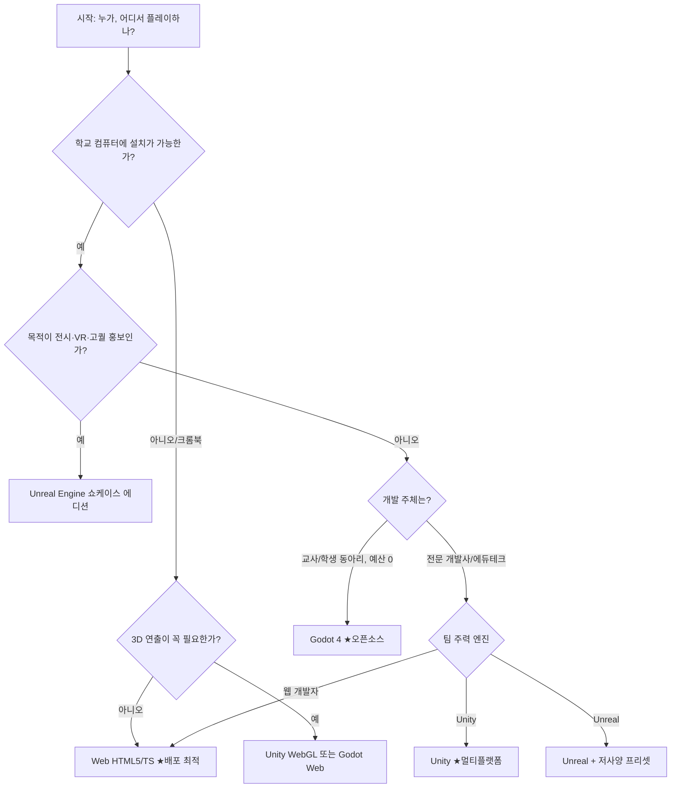

# 🌳 커밋 크래프트: 시간의 나무 (Commit Craft)
### 고등학생 대상 Git·GitHub 버전관리 교육용 게임 기획서

| 항목 | 내용 |
|---|---|
| 문서 버전 | v1.0 |
| 작성일 | 2026-10-28 |
| 장르 | 퍼즐 + 협업 건설 시뮬레이션 (교육용 기능성 게임) |
| 대상 | 고등학생 1~3학년 (프로그래밍 경험 무관), 정보 교과·동아리·방과후 |
| 플레이 시간 | 메인 스토리 약 4~6시간 (50분 차시 기준 4~8차시) |
| 인원 | 1인 싱글 / 2~4인 협업 / 학급 단위(최대 30~40명) 이벤트 |
| 후보 엔진 | Unity · Unreal Engine · Godot · Web(HTML5/TypeScript) — **10장에서 비교** |
| 관련 문서 | [엔진별 비교](ENGINE_COMPARISON.md) · [Git 시뮬레이터 명세](GIT_SIMULATOR_SPEC.md) · [MVP 스테이지 명세](STAGE_SPEC_MVP.md) · [구현 계획서](IMPLEMENTATION_PLAN.md) · [Windows 실행 환경](WINDOWS_ENVIRONMENT.md) |
| 플랫폼 | **확정: Windows PC (학교 컴퓨터실), Edge·Chrome 브라우저에서 실행** — [Windows 실행 환경 명세](WINDOWS_ENVIRONMENT.md). 크롬북·태블릿·모바일은 2차 이후 검토 |

---

## 목차
1. [기획 의도](#1-기획-의도)
2. [학습 목표와 교육과정 연계](#2-학습-목표와-교육과정-연계)
3. [게임 콘셉트와 세계관](#3-게임-콘셉트와-세계관)
4. [Git 개념 ↔ 게임 메커닉 매핑](#4-git-개념--게임-메커닉-매핑)
5. [핵심 게임 루프](#5-핵심-게임-루프)
6. [챕터·스테이지 구성](#6-챕터스테이지-구성)
7. [조작 모드: 비주얼 → 하이브리드 → 터미널](#7-조작-모드-비주얼--하이브리드--터미널)
8. [멀티플레이(협업) 설계](#8-멀티플레이협업-설계)
9. [UI/UX 설계](#9-uiux-설계)
10. [엔진·플랫폼별 구현 전략 (Unity / Unreal / Godot / Web)](#10-엔진플랫폼별-구현-전략)
11. [기술 아키텍처: Git 시뮬레이션 코어](#11-기술-아키텍처-git-시뮬레이션-코어)
12. [모든 경우의 수: 운영 시나리오 매트릭스](#12-모든-경우의-수-운영-시나리오-매트릭스)
13. [오개념 대응 설계](#13-오개념-대응-설계)
14. [평가·교사 대시보드](#14-평가교사-대시보드)
15. [수업 운영안](#15-수업-운영안)
16. [개발 일정·인력·예산](#16-개발-일정인력예산)
17. [리스크와 대응](#17-리스크와-대응)
18. [부록](#18-부록)

---

## 1. 기획 의도

### 1.1 문제 인식
- 고등학생에게 Git은 **"명령어 외우기"** 로 전달되기 쉽다. `add`, `commit`, `push`를 순서대로 외우지만 *왜* 그런지 모른다.
- Git의 핵심(스냅샷, 브랜치는 포인터, 로컬과 원격은 별개)은 **눈에 보이지 않는다**. 보이지 않으니 오개념이 생긴다.
  - "커밋하면 GitHub에 올라간다" ❌
  - "브랜치를 만들면 파일이 통째로 복사된다" ❌
  - "pull과 fetch는 같다" ❌
- 협업(충돌, Pull Request, 리뷰)은 혼자서는 체험할 수 없다.

### 1.2 해결 방향
| 원칙 | 설명 |
|---|---|
| **보이게 만든다** | 작업 공간·스테이징·저장소·원격을 *공간*으로, 커밋 그래프를 *자라는 나무*로 시각화 |
| **실수를 안전하게** | 되돌리기·충돌·push 거절을 일부러 겪게 하고, 게임 안에서 복구하게 한다 |
| **같이 해야 깨는 퍼즐** | 협업 개념(브랜치·PR·충돌)은 2인 이상이어야 풀리는 스테이지로 설계 |
| **진짜로 이어진다** | 게임 속 명령어 = 실제 Git 명령어. 마지막 챕터는 실제 GitHub에서 마무리 |

### 1.3 한 줄 콘셉트
> **"내가 지은 마을의 모든 순간을 저장하고, 친구와 평행 세계를 만들었다가 하나로 합쳐라."**

---

## 2. 학습 목표와 교육과정 연계

### 2.1 학습 목표 (Bloom 분류 기준)
| 단계 | 목표 | 확인 방법 |
|---|---|---|
| 기억 | Git 기본 명령어 10개 이상의 이름과 역할을 말할 수 있다 | 챕터 퀴즈 |
| 이해 | 작업 디렉터리·스테이징 영역·로컬 저장소·원격 저장소의 차이를 설명할 수 있다 | 4영역 분류 미니게임 |
| 적용 | 주어진 상황에서 알맞은 명령어 순서를 고를 수 있다 | 스테이지 클리어 |
| 분석 | 커밋 그래프를 보고 브랜치/병합 이력을 해석할 수 있다 | "그래프 읽기" 스테이지 |
| 평가 | 충돌 해결 방법과 PR 리뷰 의견의 타당성을 판단할 수 있다 | 리뷰 스테이지 |
| 창조 | 팀으로 실제 GitHub 저장소를 만들고 PR로 협업할 수 있다 | 최종 프로젝트 |

### 2.2 교육과정 연계 (2022 개정 교육과정 기준)
- **고등학교 『정보』**: 컴퓨팅 시스템, 프로그래밍 단원의 협업·프로젝트 활동
- **진로 선택 『소프트웨어와 생활』, 『인공지능 기초』 등**: 프로젝트 기반 수업의 협업 도구
- **창의적 체험활동(동아리)**: 코딩 동아리, 게임 개발 동아리의 협업 기초
- **고교학점제 과목**: 프로젝트 과목 시작 전 오리엔테이션 도구

> 학교/지역 교육청의 편성 과목명은 다를 수 있으므로 적용 시 학교 교육과정에 맞춰 성취기준 코드를 연결한다.

### 2.3 다루는 개념 범위
| 우선순위 | 개념 / 명령어 |
|---|---|
| ★★★ 필수 | `init` `add` `commit` `status` `log` `branch` `switch`(`checkout`) `merge` `clone` `push` `pull` `fetch` 충돌 해결, Pull Request, `.gitignore` |
| ★★ 권장 | `diff` `restore` `revert` `remote` 원격 추적 브랜치(`origin/main`), Fork, 코드 리뷰, Issue |
| ★ 심화(선택) | `rebase` `stash` `reset` `cherry-pick` `tag` `HEAD~n`, detached HEAD |

---

## 3. 게임 콘셉트와 세계관

### 3.1 스토리
> 시간이 멈춘 땅 **"버전랜드"**. 이곳 사람들은 무언가를 만들 때마다 실수를 되돌리지 못해 마을이 엉망이 되었다.
> 플레이어는 견습 **"시간 건축가"** 가 되어, 마을의 순간을 **커밋 크리스탈**에 봉인하고, **평행 세계(브랜치)** 를 열어 실험하며,
> 하늘에 떠 있는 **"허브 섬"(GitHub)** 을 통해 다른 건축가들과 함께 거대한 도시를 완성해야 한다.
> 그리고 모든 것을 망가뜨리려는 **"덮어쓰기 군단(Overwrite Legion)"** 이 나타나는데…

### 3.2 캐릭터
| 캐릭터 | 역할 |
|---|---|
| 플레이어 (시간 건축가) | 커스터마이즈 가능한 아바타 |
| **깃토리 (Gittori)** | 부엉이 멘토. 힌트·개념 설명. 실제 명령어를 말풍선으로 보여줌 |
| **헤드(HEAD) 깃발 요정** | 플레이어가 "지금 서 있는 커밋"을 따라다니는 작은 깃발. HEAD 개념을 체화 |
| **덮어쓰기 군단** | 저장 안 한 작업을 덮어쓰는 적. "커밋 안 하면 사라진다"를 체감시키는 장치 |
| **리뷰어 NPC '꼼꼼이'** | PR을 검토하고 변경 요청을 하는 NPC (싱글 모드의 협업 대체) |

### 3.3 아트 방향
- 로우폴리/2.5D 아이소메트릭 마을 (엔진 공통으로 구현 쉬움, 저사양 대응)
- **커밋 그래프 = 자라나는 나무**: 가지 = 브랜치, 열매 = 커밋, 가지가 다시 붙는 곳 = 병합
- 색상 규칙: 브랜치마다 고유 색. `main`은 금색. 원격 추적 브랜치는 점선 반투명.
- 색약 대응: 색 + 아이콘 + 패턴 3중 표시 (9.4 참조)

---

## 4. Git 개념 ↔ 게임 메커닉 매핑

> 이 표가 기획의 심장이다. 모든 메타포는 **실제 동작과 어긋나지 않는 범위**에서만 사용한다.

| Git 개념 | 게임 속 표현 | 메타포가 가르치는 핵심 | 메타포 한계 & 보정 장치 |
|---|---|---|---|
| 작업 디렉터리 (Working Directory) | **작업장**: 건물을 자유롭게 짓고 부수는 땅 | 여기서의 변경은 아직 기록되지 않음 | — |
| 스테이징 영역 (Index) | **포장대**: 다음 기록에 넣을 건물만 상자에 담기 | 원하는 변경만 골라서 커밋 | "왜 굳이?" → 스테이지 1-4에서 '일부만 커밋' 퍼즐로 필요성 체감 |
| `git add` | 건물을 포장대 위에 올리기 | 선택적 기록 | — |
| `git commit` | **커밋 크리스탈**로 마을 전체 모습을 사진처럼 봉인 + 메시지 각인 | 커밋 = 전체 스냅샷(차이 목록 아님), 메시지가 중요 | 메시지 품질 평가(“수정함” 같은 메시지는 깃토리가 지적) |
| 커밋 해시 | 크리스탈에 새겨진 고유 문양(앞 7자리) | 커밋마다 고유 ID | — |
| `git log` | **시간의 나무 전망대**에서 과거 크리스탈 열람 | 이력은 체인(부모 연결) | — |
| `git status` | **돋보기**: 작업장/포장대 상태 표시 | 수시로 확인하는 습관 | status 사용 횟수를 "습관 배지"로 보상 |
| `git diff` | 두 시점의 마을을 겹쳐 보는 **비교 렌즈** | 무엇이 바뀌었나 | — |
| HEAD | 플레이어를 따라다니는 **깃발 요정** | "지금 어디에 있나" | detached HEAD = 깃발이 가지 끝이 아닌 열매에 직접 꽂힘 (심화) |
| 브랜치 (Branch) | 나무의 **새 가지 = 평행 세계로 가는 길** | 브랜치는 커밋을 가리키는 *이름표(포인터)* | **파일 복사 아님!** 브랜치 생성 시 아무것도 복사되지 않고 이름표만 붙는 연출 |
| `git switch` / `checkout` | 평행 세계 포털 이동 → 작업장이 그 세계 모습으로 변함 | 같은 폴더, 다른 상태 | 커밋 안 한 변경이 있으면 포털이 경고 |
| `git merge` (fast-forward) | 이름표가 앞으로 *미끄러지는* 연출 | 새 커밋 없이 포인터만 이동 | — |
| `git merge` (3-way) | 두 가지가 만나 **병합 크리스탈** 생성 (부모 2개) | 병합 커밋은 부모가 둘 | — |
| 병합 충돌 (Conflict) | **같은 땅에 두 건물이 겹쳐 지지직** 거림 → 하나 고르거나 둘을 섞어 재건축 | 같은 부분을 다르게 바꾸면 사람이 결정 | 충돌 표시자(`<<<<<<<` `=======` `>>>>>>>`)를 실제 텍스트로도 보여줌 |
| 원격 저장소 (Remote) | 하늘의 **허브 섬** (GitHub) | 로컬과 원격은 *별개의 복사본* | 섬끼리는 자동 동기화되지 않음을 강조 |
| `git clone` | 허브 섬을 통째로 복제해 **내 섬**을 띄움 | 전체 이력까지 복제 | — |
| `git push` | **비행선**에 크리스탈을 실어 허브 섬으로 보내기 | 커밋 ≠ 업로드. push해야 공유됨 | 원격이 앞서 있으면 **비행선 착륙 거부(rejected)** |
| `git fetch` | **망원경 + 우편함**: 허브 섬의 새 크리스탈을 받아 *우편함(origin/main)*에만 보관 | 받아오기만 하고 내 작업엔 안 섞음 | 우편함 가지는 점선으로 표시 |
| `git pull` | 우편함 열고 바로 내 가지에 합치기 | **pull = fetch + merge** | 연출에서 두 단계가 연속으로 일어나는 것을 슬로모션으로 보여줌. 최신 Git은 갈라진 상태의 pull에 설정(`pull.rebase false`)이 필요 → 5-1에서 직접 설정 |
| 원격 추적 브랜치 `origin/main` | 반투명 점선 이름표 | 마지막으로 본 원격 상태 | — |
| Fork | 남의 허브 섬을 **내 계정 허브 섬으로 복제** | Fork(서버 측) vs Clone(내 컴퓨터) | 두 동작을 한 스테이지에서 비교 |
| Pull Request | **마을 회의 제안서**: "내 가지를 main에 합쳐주세요" | PR은 Git 명령어가 아니라 GitHub 기능 | 깃토리가 "이건 Git이 아니라 GitHub의 기능이야!" 라고 명시 |
| 코드 리뷰 | 검사관이 제안서에 **도장/코멘트** | 합치기 전 검토 문화 | — |
| Issue | 마을 게시판 **의뢰서** | 할 일 관리 | — |
| `.gitignore` | **투명 망토**: 덮인 물건은 기록에서 제외 | 비밀번호·임시파일 제외 | API 키를 커밋하면 "도둑 이벤트" 발생 (보안 교육) |
| `git restore` | 작업장의 건물을 마지막 크리스탈 모습으로 복원 | 커밋 전 변경 취소 | — |
| `git revert` | **반대 주문 크리스탈**을 새로 추가 | 이력을 지우지 않고 되돌림 → 협업에 안전 | — |
| `git reset` (심화) | 시간 자체를 되감기 (경고 연출) | 공유된 이력에선 위험 | 이미 push한 뒤 reset하면 팀원 섬이 흔들리는 연출 |
| `git stash` (심화) | 작업 중인 건물을 **임시 서랍**에 넣기 | 급한 전환 시 사용 | — |
| `git rebase` (심화) | 가지를 잘라 다른 곳에 **다시 접붙이기** (새 열매로 다시 맺힘 = 해시 바뀜) | 이력 재작성 | "공유 브랜치는 rebase 금지" 규칙 |
| `git tag` (심화) | 크리스탈에 **깃발 리본** | 릴리스 표시 | — |

---

## 5. 핵심 게임 루프

### 5.1 미시 루프 (1~3분)
```
의뢰 확인 → 작업장에서 건설/수정 → 돋보기(status)로 확인
     → 포장대(add) → 크리스탈 봉인(commit) → 보상(나무 성장 + 별점)
```

### 5.2 중간 루프 (스테이지, 5~10분)
```
목표 제시 (예: "축제 장식은 평행 세계에서 실험하고, 성공하면 main에 합쳐라")
  → 계획 (어떤 명령을 어떤 순서로?)
  → 실행 (비주얼/터미널 조작)
  → 이벤트 (충돌, push 거절, 덮어쓰기 군단 습격)
  → 해결 → 결과 그래프를 "모범 그래프"와 비교 → 별점(★1~3)
```

### 5.3 거시 루프 (챕터/전체)
```
새 개념 해금 → 스테이지 → 챕터 보스(종합 퍼즐) → 새 지역 해금
  → 최종: 친구들과 허브 섬에서 도시 완성 → 실제 GitHub 졸업 미션
```

### 5.4 별점 기준 (모든 스테이지 공통)
| 별 | 조건 |
|---|---|
| ★ | 목표 상태 도달 (최종 커밋 그래프/파일 상태가 정답과 일치) |
| ★★ | + 최소 명령 수 이내 또는 불필요한 위험 명령 미사용 |
| ★★★ | + 좋은 커밋 메시지(규칙 기반 평가) + 힌트 미사용 |

> **정답 판정은 "명령어 순서"가 아니라 "최종 상태"로 한다.** 같은 결과를 내는 여러 방법을 모두 인정한다 (예: `git switch -c` vs `git branch` + `git switch`).

---

## 6. 챕터·스테이지 구성

> 표기: 🧍 싱글 / 👥 협업(2인 이상, 싱글은 NPC 대체) / 🧪 선택 심화

### 프롤로그. 덮어쓰기의 비극 (5분)
- 저장 개념이 없는 마을에서 건물을 지었다가 실수로 다 날려버리는 체험.
- 목적: **"버전관리가 왜 필요한가"** 감정적으로 체감. `최종.psd`, `최종_진짜최종.psd` 같은 파일명 개그로 공감 유도.

### 챕터 1. 첫 번째 크리스탈 — 로컬 기초 🧍
| # | 스테이지 | 배우는 것 | 퍼즐 예시 |
|---|---|---|---|
| 1-1 | 시간의 씨앗 | `git init` | 빈 땅에 시간의 씨앗을 심어 저장소 생성 (`.git` = 씨앗 속 기록 보관함) |
| 1-2 | 첫 봉인 | `add` → `commit` | 집 1채를 짓고 첫 커밋 |
| 1-3 | 돋보기 습관 | `status` | 숨은 변경 3개를 status로 찾아내기 |
| 1-4 | 골라 담기 | 스테이징의 의미 | 집·우물·쓰레기더미 중 **집과 우물만** 커밋하기 |
| 1-5 | 좋은 이름 | 커밋 메시지 | 메시지 카드 중 좋은 것 고르기 ("수정" vs "광장에 분수 추가") |
| 1-6 | 투명 망토 | `.gitignore` | 비밀 일기(비밀번호 파일)를 기록에서 제외 |
| 보스 | 덮어쓰기 군단 1차 습격 | 종합 | 습격 전까지 3개 기능을 각각 별도 커밋으로 봉인 |

### 챕터 2. 시간의 전망대 — 이력 탐색과 되돌리기 🧍
| # | 스테이지 | 배우는 것 |
|---|---|---|
| 2-1 | 과거 열람 | `log`, `log --oneline` |
| 2-2 | 비교 렌즈 | `diff` (작업장 vs 포장대 vs 커밋) |
| 2-3 | 실수 지우개 | `restore` (커밋 전 변경 취소) |
| 2-4 | 반대 주문 | `revert` (이력 보존 되돌리기) |
| 2-5 🧪 | 시간 여행 | `switch --detach` / `checkout <hash>`, detached HEAD 경험 후 복귀 |
| 보스 | 범인 찾기 | log와 diff로 "분수를 망가뜨린 커밋"을 찾아 revert |

### 챕터 3. 평행 세계 — 브랜치 🧍
| # | 스테이지 | 배우는 것 |
|---|---|---|
| 3-1 | 이름표의 비밀 | `branch` — 브랜치 생성 시 **아무것도 복사되지 않는** 연출 |
| 3-2 | 포털 이동 | `switch`, HEAD 깃발 이동 |
| 3-3 | 두 세계 동시 건설 | 브랜치마다 다른 커밋 쌓기 → 나무가 갈라짐 |
| 3-4 | 포털 경고 | 커밋 안 한 변경이 있을 때 switch 시 발생하는 상황 |
| 3-5 | 가지 정리 | `branch -d` |
| 보스 | 축제 준비 | `feature/festival`, `feature/market` 두 브랜치로 동시 기획 |

### 챕터 4. 세계의 합류 — 병합과 충돌 🧍
| # | 스테이지 | 배우는 것 |
|---|---|---|
| 4-1 | 미끄러지는 이름표 | Fast-forward 병합 |
| 4-2 | 두 부모의 크리스탈 | 3-way 병합, 병합 커밋 |
| 4-3 | 지지직! | 첫 충돌. 같은 땅에 다른 건물 |
| 4-4 | 충돌 표시 읽기 | `<<<<<<<`, `=======`, `>>>>>>>` 텍스트 편집 미니게임 |
| 4-5 | 둘 다 살리기 | 두 변경을 섞어서 해결 |
| 4-6 | 병합 취소 | `merge --abort` |
| 보스 | 대합류 | 3개 브랜치를 순서대로 병합하며 충돌 2건 해결 |

### 챕터 5. 하늘의 허브 섬 — 원격 저장소 🧍👥
| # | 스테이지 | 배우는 것 |
|---|---|---|
| 5-1 | 허브 섬 발견 | GitHub = 원격 저장소 호스팅 서비스 (Git ≠ GitHub) |
| 5-2 | 섬 복제 | `clone` |
| 5-3 | 비행선 출발 | `push` — **커밋만으론 섬에 안 올라감** 체험 |
| 5-4 | 망원경과 우편함 | `fetch`, `origin/main` 점선 이름표 |
| 5-5 | 우편함 열기 | `pull` = `fetch` + `merge` 분해 연출 |
| 5-6 | 착륙 거부! | 친구가 먼저 push → 내 push **rejected** → pull 후 다시 push |
| 5-7 | 연결선 | `remote add`, `push -u origin main` (로컬에서 시작한 저장소 연결) |
| 보스 | 두 섬의 경주 | 2인(또는 NPC)이 동시에 같은 원격에 push하며 거절·병합·충돌 처리 |

### 챕터 6. 마을 회의 — GitHub 협업 👥
| # | 스테이지 | 배우는 것 |
|---|---|---|
| 6-1 | 의뢰 게시판 | Issue 작성, 담당자 지정 |
| 6-2 | 제안서 | 브랜치 push → **Pull Request** 생성 |
| 6-3 | 검사관 꼼꼼이 | 코드 리뷰: 코멘트, 변경 요청, 승인 |
| 6-4 | 수정 후 재제출 | PR에 커밋 추가 시 자동 반영 |
| 6-5 | 남의 섬 돕기 | **Fork** → clone → 브랜치 → PR (오픈소스 기여 흐름) |
| 6-6 | 보호된 광장 | 브랜치 보호 규칙 (main 직접 push 금지) |
| 보스 | 마을 대축제 | 팀원 각자 Issue 하나씩 맡아 PR → 서로 리뷰 → 병합 |

### 챕터 7. 시간 마법 심화 🧪 (선택)
| # | 스테이지 | 배우는 것 |
|---|---|---|
| 7-1 | 임시 서랍 | `stash`, `stash pop` |
| 7-2 | 접붙이기 | `rebase` (해시가 바뀌는 연출) + "공유 브랜치 rebase 금지" |
| 7-3 | 열매 옮기기 | `cherry-pick` |
| 7-4 | 시간 되감기의 대가 | `reset --soft/--mixed/--hard` 비교, push 후 reset의 위험 |
| 7-5 | 리본 달기 | `tag`, 릴리스 |

### 에필로그. 졸업 미션 — 진짜 세계로 (실제 GitHub)
- 게임 밖 실제 GitHub에서 팀 저장소를 만들고, 각자 자기소개 파일을 PR로 추가.
- 게임은 체크리스트와 진행 확인(선택: GitHub API 연동)만 제공. 상세는 [12.3](#123-실제-git-연동-수준-선택지) 참조.

### 6.1 스테이지 상태 예시 (챕터 4 보스 목표 그래프)


### 6.2 스테이지 5-6 "착륙 거부" 흐름 예시


---

## 7. 조작 모드: 비주얼 → 하이브리드 → 터미널

학생 수준 차이가 크므로 **같은 스테이지를 세 가지 모드로 플레이**할 수 있게 한다.

| 모드 | 조작 | 대상 | 학습 효과 |
|---|---|---|---|
| **비주얼 모드** | 드래그·버튼 (포장대에 끌어 놓기, 크리스탈 버튼) | 완전 입문자, 저학년, 태블릿 | 개념 이해 |
| **하이브리드 모드** (기본값) | 버튼을 누르면 **해당 Git 명령어가 터미널 창에 자동 입력**되어 보임 | 대부분 학생 | 개념 ↔ 명령어 연결 |
| **터미널 모드** | 실제처럼 명령어 타이핑 (자동완성·오타 교정 힌트) | 경험자, 심화 | 실전 전이 |

- 챕터가 진행될수록 하이브리드 → 터미널로 **자연스럽게 유도** (터미널 모드 클리어 시 보너스 별).
- 터미널 모드 지원 명령: 부록 18.1 참조. 미지원 명령 입력 시 "이 섬에선 아직 그 마법이 봉인되어 있어" 메시지 + 실제 의미 설명.
- 오타 교정: `git comit` → "혹시 `git commit`?" (실제 Git의 제안 기능과 유사하게)
- **명령어 영어 + 설명 한국어** 원칙. 명령어 자체는 절대 한글화하지 않는다.

---

## 8. 멀티플레이(협업) 설계

> ✅ **협업 온라인은 MVP 필수.** 상세 설계(접속 방식, 방·팀, 협업 스테이지, 통신 규약, 안전)는 [협업 설계서](MULTIPLAYER_DESIGN.md)를 따른다. 아래는 초기 구상이다.

### 8.1 플레이 형태
| 형태 | 설명 | 네트워크 |
|---|---|---|
| 싱글 | 협업 상대를 **NPC 동료**(스크립트)가 대신함 | 불필요 |
| 핫시트 | 한 PC에서 2명이 번갈아 (로컬 섬 2개를 화면 분할) | 불필요 |
| LAN/교실 서버 | 교사 PC가 "허브 섬" 서버 역할 | 교실 내부망 |
| 온라인 | 클라우드 서버가 허브 섬 역할, 방 코드로 입장 | 인터넷 |
| 학급 이벤트 | 30명이 하나의 거대 도시 저장소에 PR (교사가 메인테이너) | 인터넷/내부망 |

### 8.2 협업 설계 원칙
- **허브 섬 상태만 서버가 관리**하고, 각자의 로컬 섬은 클라이언트에 있음 → 실제 Git 구조와 동일. "로컬과 원격은 별개"가 구조적으로 체험된다.
- 실시간 동기화가 아니라 **push/pull 할 때만 동기화** → 실시간 협업 툴(구글 문서)과 Git의 차이를 체감.
- 역할 카드: 메인테이너 / 기여자 / 리뷰어 를 스테이지마다 순환.
- 의도된 충돌 설계: 두 학생에게 "같은 광장 위치"를 서로 다르게 꾸미라는 과제를 비밀리에 배분.

### 8.3 부정적 상호작용 방지
- 다른 학생의 커밋을 지우는 행위(force push)는 기본 비활성. 심화 스테이지에서만 "위험 체험"으로 허용하고 복구 이벤트 연동.
- 채팅은 **프리셋 이모트/정해진 문장** 기본, 자유 채팅은 교사가 켤 때만. PR 코멘트는 욕설 필터 적용.

---

## 9. UI/UX 설계

### 9.1 화면 구성 (PC 기본)
```
┌──────────────────────────────────────────────────────────────┐
│ [챕터/스테이지명]        [목표: 축제 브랜치를 main에 병합]   ★☆☆ │
├───────────────────────────────────┬──────────────────────────┤
│                                   │   🌳 시간의 나무          │
│        마을 (작업장) 3D/2.5D 뷰     │   (커밋 그래프 실시간)     │
│                                   │   ● main ← 🚩HEAD         │
│                                   │   ├─● feature/festival    │
├──────────────┬────────────────────┴──────────────────────────┤
│ 📦 포장대     │ > 터미널                                       │
│ (스테이징)    │ $ git status                                    │
│ [집] [우물]   │ On branch main ...                             │
├──────────────┴───────────────────────────────────────────────┤
│ [돋보기] [포장] [봉인] [가지] [포털] [합치기] [비행선] [우편함]  🦉힌트 │
└──────────────────────────────────────────────────────────────┘
```

### 9.2 "4개의 공간" 상시 표시
화면 상단에 미니맵 형태로 항상 보여준다.
```
[작업장] --add--> [포장대] --commit--> [내 저장소] --push--> [허브 섬]
   ^                                    |   ^                    |
   +----------- restore / switch -------+   +---- fetch/pull ----+
```
변경 사항이 어느 공간에 있는지 아이콘이 이동하며 표시된다. **가장 중요한 오개념 예방 장치.**

### 9.3 플랫폼별 UI 대응
| 플랫폼 | 대응 |
|---|---|
| PC (마우스+키보드) | 기본 레이아웃, 터미널 모드 완전 지원 |
| 크롬북/저사양 노트북 | 2D 렌더 모드 강제, 그림자·파티클 끔 |
| 태블릿 (터치) | 비주얼 모드 기본, 버튼 최소 48px, 터미널은 **명령어 블록 조립** 방식 (스크래치처럼) |
| 모바일 (선택) | 복습·퀴즈 전용 경량 앱 (세로 모드, 그래프 읽기 퀴즈 중심) |
| 전자칠판/프로젝터 | 교사 시연 모드: 글자 1.5배, 그래프 크게 |

### 9.4 접근성
- 색약: 브랜치를 색 + 아이콘(★◆▲) + 선 패턴(실선/점선/이중선)으로 구분
- 텍스트 크기 3단계, 고대비 테마
- 키보드만으로 전체 조작 가능 (Tab 이동)
- 자막/텍스트 대체: 모든 음성 대사 자막 제공
- 읽기 속도 조절, 애니메이션 줄이기 옵션 (멀미/주의력 고려)
- 다국어: 한국어 기본, 영어 지원 (다문화 학생 고려, 추후 확장)

---

## 10. 엔진·플랫폼별 구현 전략

> 핵심 전략: **Git 시뮬레이션 코어를 엔진과 분리**한다 (11장). 그러면 어떤 엔진을 고르든 같은 규칙·같은 스테이지 데이터를 재사용할 수 있고, 엔진 교체·멀티 플랫폼 출시가 가능해진다.

### 10.1 엔진 비교 요약

| 기준 | Unity | Unreal Engine 5 | Godot 4 | Web (TypeScript + Phaser/React/Three.js) |
|---|---|---|---|---|
| 언어 | C# | C++ / Blueprint | GDScript / C# | TypeScript / JavaScript |
| 학습 난이도 (개발팀) | 중 | 상 | 하~중 | 하~중 (웹 개발자 기준) |
| **브라우저 실행 (설치 없음)** | ◎ WebGL/WebGPU 빌드 | △ 공식 HTML5 미지원 → Pixel Streaming(서버 렌더) 필요 | ○ Web 내보내기 (GDScript만, C# 웹 내보내기 제한) | ◎ 네이티브 |
| 크롬북 | ○ (WebGL) | ✕ (Pixel Streaming 시만 △) | ○ (Web) | ◎ |
| 저사양 학교 PC | ○ | △ (최적화 비용 큼) | ◎ | ◎ |
| 태블릿/모바일 | ◎ | ○ (무거움) | ○ | ○ (반응형 웹) |
| 2.5D/로우폴리 표현 | ◎ | ◎ (오버스펙) | ○ | ○ (Three.js 사용 시) |
| 고품질 3D·VR 전시 | ○ | ◎ | △ | △ |
| UI 대량 제작 (터미널·그래프) | ○ UI Toolkit | △ UMG (다소 번거로움) | ◎ Control 노드 | ◎ HTML/CSS 최강 |
| 멀티플레이 | ○ Netcode for GameObjects / Photon 등 | ◎ 내장 리플리케이션 | ○ High-level Multiplayer, WebSocket/WebRTC | ○ WebSocket (Socket.IO, Colyseus 등) |
| 실제 Git 라이브러리 연동 | LibGit2Sharp (데스크톱만, WebGL 불가) | libgit2 (C++) | GDExtension + libgit2 (데스크톱) | **isomorphic-git (브라우저에서 실제 Git 동작)** |
| 빌드 용량 (대략) | 웹 10~40MB | 데스크톱 수백MB~수GB | 웹 10~40MB | 수 MB |
| 라이선스 비용 | Personal 무료(매출·펀딩 기준 상한 있음), 교육용 라이선스 | 무료, 일정 매출 초과 시 로열티 | **MIT, 완전 무료** | 무료 (오픈소스 라이브러리) |
| 인력 수급 (국내) | ◎ 가장 많음 | ○ | △~○ | ◎ |
| 학교 보안 정책(설치 금지) 대응 | ○ (웹 빌드) | ✕ | ○ (웹 빌드) | ◎ |

> ◎ 매우 적합 ○ 적합 △ 제한적 ✕ 부적합.
> 라이선스 조건·웹 내보내기 지원 범위는 버전마다 바뀌므로 **개발 착수 시점에 공식 문서로 재확인**한다.

### 10.2 Unity 구현안
- **추천 상황**: 팀에 Unity 경험자가 있음 / PC + 웹 + 태블릿을 하나의 코드로 / 상용 에듀테크 제품
- **구조**
  - Git 코어: 순수 C# 라이브러리(.NET Standard)로 분리 → Unity 의존성 0, NUnit으로 단위 테스트
  - 마을 뷰: URP + 로우폴리 에셋, 타일맵 기반 배치
  - 커밋 그래프: UI Toolkit 커스텀 VisualElement 또는 LineRenderer
  - 터미널: TextField + 자체 파서
  - 데이터: ScriptableObject 또는 JSON(StreamingAssets)으로 스테이지 정의
  - 멀티: 교실용은 Netcode for GameObjects + Relay, 대안으로 Photon Fusion. 웹 빌드는 WebSocket 전송 사용
  - 저장: 로컬 PlayerPrefs/파일 + (선택) 학급 서버 API
- **주의점**
  - WebGL에서는 스레드·파일시스템 제약 → 실제 Git(LibGit2Sharp) 대신 자체 시뮬레이터 사용
  - WebGL 첫 로딩 용량 관리 (Addressables, 압축 Brotli/Gzip, 서버 MIME 설정)
  - 한글 폰트: TextMeshPro용 한글 폰트 에셋(서브셋 2,350자 + 영문) 제작
  - 모바일 브라우저 WebGL은 메모리 한계가 있어 태블릿은 네이티브 앱 빌드 권장

### 10.3 Unreal Engine 구현안
- **추천 상황**: 박람회·과학관 **전시용**, VR 체험관, 고사양 컴퓨터실, 홍보 영상 / 팀이 Unreal 숙련
- **구조**
  - Git 코어: 순수 C++ 모듈(엔진 비의존) + Blueprint 노출 함수 (`UGitSimSubsystem`)
  - 마을 뷰: Nanite/Lumen 사용 가능하나 학교 배포 시 **Scalability 최저 프리셋** 별도 제공
  - 커밋 그래프: UMG 커스텀 위젯 또는 3D 공간에 실제 "나무"를 렌더 (전시용 연출 강점)
  - 멀티: 내장 리플리케이션 + Dedicated Server (교사 PC 또는 클라우드)
  - VR 모드(선택): 손으로 크리스탈을 집어 포장대에 올리는 체감형 add/commit
- **주의점**
  - 공식 웹 배포가 없음 → 브라우저 제공이 필요하면 **Pixel Streaming** (서버 GPU 비용 발생, 학교망 대역폭 부담)
  - 설치 용량·사양이 커서 일반 학교 컴퓨터실 보급형으로는 부적합할 수 있음
  - UI 위주 게임에는 오버스펙 → 개발 기간·비용 증가
- **결론**: 메인 교실 배포용보다는 **"쇼케이스 에디션"** 으로 별도 구성하는 것이 현실적

### 10.4 Godot 구현안
- **추천 상황**: 학생 동아리·교사 개인 개발 / 예산 0원 / 오픈소스 공개 배포 / 가벼운 웹 배포
- **구조**
  - Git 코어: GDScript 클래스(`GitRepo`, `Commit`, `Ref`) 또는 GDExtension(C++/Rust)
  - 마을 뷰: 2D TileMap 아이소메트릭 (가장 가볍고 빠름) 또는 3D 로우폴리
  - 커밋 그래프: `_draw()` 커스텀 컨트롤
  - 터미널: RichTextLabel + LineEdit
  - 데이터: JSON 또는 Resource(.tres)
  - 멀티: High-level Multiplayer API, 웹은 WebSocketMultiplayerPeer / WebRTC
- **주의점**
  - **웹 내보내기는 GDScript 기준**으로 설계 (C# 사용 시 웹 내보내기 제약 확인 필요)
  - 웹 빌드 스레드 옵션에 따라 호스팅 서버 헤더(Cross-Origin Isolation) 설정 필요 여부가 달라짐 → 단일 스레드 내보내기 권장
  - 국내 인력 풀이 Unity보다 작음
- **장점**: 오픈소스(MIT)라 **학생들이 게임 자체의 소스를 GitHub에서 Fork해 기여**하는 메타 수업 가능 — 교육 목적과 완벽히 맞물림

### 10.5 Web(엔진 없이 HTML5) 구현안
- **추천 상황**: 학교 배포가 최우선 / 크롬북 / 설치 금지 / 빠른 업데이트 / 실제 Git 동작 체험
- **구조**
  - 프레임워크: React(UI) + Phaser 3(2D 마을) 또는 Three.js/react-three-fiber(3D)
  - 커밋 그래프: SVG/D3.js
  - 터미널: 브라우저 기본 입력창 + 터미널 스타일 출력 (xterm.js 등은 한글 조합 입력 문제 가능성 → P0 스파이크에서 검증)
  - Git 코어: ① 자체 TypeScript 시뮬레이터(기본) ② **isomorphic-git + 가상 파일시스템(LightningFS)** 으로 *브라우저 안에서 진짜 Git* 실행(심화 모드)
  - 멀티: Node.js + WebSocket(Colyseus 등), 허브 섬 = 서버의 bare 저장소 or 자체 저장소 모델
  - 오프라인: PWA(Service Worker)로 설치 없이 오프라인 실행
- **주의점**
  - 3D 연출은 엔진 대비 제작 비용 증가
  - 학교 웹필터가 게임 사이트를 차단할 수 있음 → 교육청 화이트리스트 등록, 학교 도메인 자체 호스팅 옵션

### 10.6 엔진 선택 의사결정 트리


### 10.7 최종 권장안
> ✅ **최종 결정: Godot 4.7.2 + GDScript** (Windows exe + 웹 내보내기 이중 배포) — [Godot 아키텍처](GODOT_ARCHITECTURE.md). 아래 표는 결정 전 비교 기록이다.
>
> 가중치 점수표와 항목별 상세 비교는 [엔진별 비교 문서](ENGINE_COMPARISON.md) 참조 (학교 보급형 기준: Web 93 · Godot 76 · Unity 74 · Unreal 44).

| 순위 | 구성 | 이유 |
|---|---|---|
| **1안 (권장)** | **Web(TypeScript) 단독** — 게임 + 교사 대시보드 + 실제 Git(isomorphic-git) | 학교 배포·크롬북·한글 입력·UI 제작·업데이트 모두 가장 유리 |
| 3D 강화안 | **엔진 독립 Git 코어 + Unity(PC/태블릿/WebGL)** + Web 대시보드 | 3D 연출·앱스토어 출시가 필요할 때. WebGL 한글 입력 대책을 초기에 검증 |
| 저예산안 | **Godot 4 (GDScript, Web 내보내기) + 오픈소스 공개** | 0원, 가벼움, "게임 소스로 Git 실습" 메타 교육 |
| 확장안 | 위 중 하나 + **Unreal 쇼케이스 에디션** | 전시·VR·홍보 전용으로 별도 소규모 제작 |
| 비상안 | **언플러그드 카드 보드게임** (12.4) | 기기·네트워크 없음 |

> 코어를 TypeScript로 짜면 Web은 그대로, Unity는 C#으로 포팅(규칙 동일·테스트 벡터 공유), Godot은 GDScript 포팅. **스테이지 JSON과 정답 테스트 벡터를 공용 자산으로 두는 것**이 엔진 다변화의 핵심.

---

## 11. 기술 아키텍처: Git 시뮬레이션 코어

### 11.1 계층 구조
```
┌───────────────────────────────────────────────┐
│ 프레젠테이션 계층 (엔진별)                      │  Unity / Unreal / Godot / Web
│  - 마을 뷰, 커밋 그래프 뷰, 터미널 뷰, 연출      │
├───────────────────────────────────────────────┤
│ 게임 로직 계층                                   │
│  - 스테이지 매니저, 목표 판정, 힌트, 별점, 이벤트 │
├───────────────────────────────────────────────┤
│ Git 시뮬레이션 코어 (엔진 독립, 순수 로직)        │
│  - 객체 모델(커밋/트리/블롭), refs, HEAD, index │
│  - 명령 파서 & 실행기, 상태 직렬화(JSON)         │
├───────────────────────────────────────────────┤
│ (선택) 실제 Git 어댑터                           │  isomorphic-git / libgit2 / LibGit2Sharp
│ (선택) 네트워크 어댑터 (허브 섬 서버)             │  WebSocket / 엔진 넷코드
└───────────────────────────────────────────────┘
```

### 11.2 데이터 모델 (언어 중립 의사코드)
```text
File        { path: string, content: string }            // 게임에선 "건물 정의" JSON 문자열
Snapshot    { files: Map<path, contentHash> }             // 커밋 시점 전체 상태
Commit      { id: hash, parents: [hash], snapshot, message, author, time }
Ref         { name: "main" | "feature/x" | "origin/main", target: commitId }
Head        { type: "branch", name } | { type: "detached", commitId }
Index       { files: Map<path, contentHash> }             // 포장대
WorkingDir  { files: Map<path, content> }                 // 작업장
Repository  { objects, refs, head, index, workingDir, remotes: Map<name, RemoteRef> }
RemoteServer{ repos: Map<id, BareRepository> }             // 허브 섬
```
- **해시**: 실제 SHA-1 대신 내용 기반 짧은 해시(결정적) 사용 → 스테이지 재현성 확보. 화면엔 7자리만.
- **병합**: 3-way merge를 "파일(건물 칸) 단위 + 줄 단위" 두 단계로 구현. 충돌 시 실제와 동일한 충돌 표시 텍스트 생성.
- **push 규칙**: 원격 ref가 로컬 커밋의 조상이 아니면 `rejected (non-fast-forward)`.

### 11.3 명령 처리 파이프라인
```
입력 문자열 → 토크나이저 → 명령 매칭(별칭: checkout ↔ switch/restore)
 → 사전 검증(오류 메시지는 실제 Git 문구 + 한국어 해설 병기)
 → 실행(상태 변경) → 이벤트 발행(CommitCreated, BranchMoved, ConflictOccurred…)
 → 프레젠테이션 계층이 이벤트를 받아 연출
```
- 모든 상태 변경은 **이벤트 소싱**으로 기록 → 되감기(실수 시 "스테이지 되돌리기"), 리플레이, 교사용 학습 로그 분석에 그대로 사용.

### 11.4 스테이지 정의 데이터 (공용 JSON 예시)
```json
{
  "id": "5-6",
  "title": "착륙 거부!",
  "mode": ["visual", "hybrid", "terminal"],
  "initialState": {
    "local":  { "branches": { "main": "c2" }, "head": "main",
                "commits": [ {"id":"c1","parents":[],"msg":"광장 조성"},
                             {"id":"c2","parents":["c1"],"msg":"분수 추가"} ] },
    "remote": { "branches": { "main": "c3" },
                "commits": [ {"id":"c3","parents":["c1"],"msg":"[친구] 가로등 설치"} ] }
  },
  "goal": {
    "remote.branches.main": { "containsCommits": ["c2", "c3"] },
    "local.workingDir": "clean"
  },
  "events": [
    { "on": "pushRejected", "hint": "허브 섬에 네가 모르는 크리스탈이 있어. 먼저 받아와야 해!" }
  ],
  "stars": { "maxCommands": 4, "forbid": ["push --force"] },
  "concepts": ["push", "pull", "fetch", "non-fast-forward"]
}
```

### 11.5 테스트 전략
- 코어는 **테스트 벡터(입력 상태 + 명령 시퀀스 → 기대 상태)** 를 JSON으로 수백 개 작성 → 모든 엔진 포팅본이 동일하게 통과해야 함.
- (개발 시) 같은 시퀀스를 실제 `git`으로 실행해 결과 그래프를 비교하는 **차등 테스트(differential test)** 스크립트로 시뮬레이터 정확성 검증.
- 플레이테스트: 실제 고등학생 대상 3회 (알파/베타/정식 전) — 클리어율·힌트 사용률·오답 패턴 수집.

### 11.6 서버(허브 섬) 구성 선택지
| 구성 | 장점 | 단점 | 적합 |
|---|---|---|---|
| 서버 없음 (NPC 동료) | 비용 0, 오프라인 | 진짜 협업 아님 | 자율학습, 네트워크 차단 학교 |
| 교사 PC 로컬 서버 | 외부망 불필요, 개인정보 안전 | 교사 PC 설정 필요 | 일반 교실 |
| 클라우드 서버 | 집에서도 협업 | 운영비, 개인정보 처리방침 필요 | 상용/교육청 보급 |
| 실제 GitHub 연동 | 진짜 경험 | 계정 생성 필요, 연령·정책 이슈 | 에필로그/심화 |

---

## 12. 모든 경우의 수: 운영 시나리오 매트릭스

### 12.1 환경 변수별 대응표
| 변수 | 경우 | 대응 |
|---|---|---|
| **기기** | 데스크톱(Win/macOS) | 네이티브 빌드 또는 웹 |
| | 크롬북 | 웹(Web/Unity WebGL/Godot Web) |
| | 태블릿(iPad/갤럭시탭) | 네이티브 앱 또는 웹 + 비주얼 모드 |
| | 스마트폰 | 복습·퀴즈 경량 모드 |
| | 기기 없음 | 언플러그드 카드 게임 (12.4) |
| **사양** | 저사양 | 2D 모드, 이펙트 끔, 30fps 고정 |
| | 고사양 | 3D, 고품질 연출 |
| **네트워크** | 인터넷 가능 | 온라인 협업 + 클라우드 저장 |
| | 교내망만 | 교사 PC 서버(LAN) |
| | 오프라인 | 싱글(NPC) + 로컬 저장, 진도는 QR/코드로 교사에게 전달 |
| | 게임 사이트 차단 | 학교 도메인 자체 호스팅 / 교육청 화이트리스트 / 오프라인 설치본 |
| **설치 권한** | 설치 가능 | 데스크톱 빌드 |
| | 설치 불가 | 웹/PWA |
| **수업 시간** | 1차시(50분) | 프롤로그 + 챕터 1 (로컬 커밋까지) |
| | 2차시 블록(100분) | 챕터 1~3 |
| | 4차시 | 챕터 1~6 핵심 스테이지만 |
| | 8차시/동아리 | 전체 + 에필로그 실제 GitHub |
| | 자기주도/방학 | 전체 + 심화 7장 |
| **인원** | 1인 | NPC 협업 |
| | 2인(짝) | 핫시트 또는 2인 방 |
| | 4인 모둠 | 역할 순환 협업 방 |
| | 학급 전체 | 학급 이벤트 모드(교사 메인테이너) |
| **학생 수준** | 컴퓨터 입문 | 비주얼 모드, 힌트 자동 |
| | 코딩 경험 있음 | 하이브리드 기본 |
| | Git 경험 있음 | 배치 고사(스킵 테스트) 후 챕터 5+ 또는 터미널 모드 |
| **교사 수준** | Git 미경험 교사 | 교사용 가이드 영상, 수업 슬라이드, 정답 리플레이 제공 |
| | 숙련 교사 | 스테이지 에디터로 직접 문제 제작 |
| **계정 정책** | 학생 계정 생성 가능 | 학급 코드 로그인 |
| | 계정 불가(개인정보) | 익명 닉네임 + 기기 로컬 저장 |
| **특수 요구** | 시각/색각 이상 | 고대비, 패턴 구분, 확대 |
| | 다문화/외국어 | 영어 UI |
| | 주의력 어려움 | 짧은 스테이지, 애니메이션 줄이기, 체크리스트형 목표 |

### 12.2 개발 주체별 시나리오
| 주체 | 추천 엔진 | 범위 | 기간 |
|---|---|---|---|
| 학생 동아리 (3~5명) | Godot 또는 Web | 챕터 1~5, 2D | 1학기 |
| 교사 1인 + 학생 | Web 또는 Godot | 챕터 1~4 + 실제 GitHub 안내 | 2~3개월 |
| 교육청/연구회 | Web 또는 Unity WebGL | 전체 + 교사 대시보드 | 6~9개월 |
| 에듀테크 기업 | Unity (+Web) | 전체 + 멀티 + LMS 연동 | 9~12개월 |
| 과학관/박람회 | Unreal | 챕터 1, 3, 4 핵심만, VR 옵션 | 3~6개월 |

### 12.3 실제 Git 연동 수준 선택지
| 레벨 | 방식 | 장점 | 단점 |
|---|---|---|---|
| L0 | 완전 시뮬레이션 | 안전, 어디서나 동작 | 실전 전이에 한 단계 필요 |
| L1 | 브라우저 안 실제 Git (isomorphic-git) | 진짜 Git 객체, 설치 불필요 | 웹 구현에 한정 |
| L2 | 서버 샌드박스 컨테이너의 실제 git CLI | 진짜 터미널 | 서버 비용, 보안 관리 |
| L3 | 학생 PC의 실제 git + 게임은 결과 검사만 | 완전 실전 | 설치 필요, 환경 편차 |
| L4 | 실제 GitHub 저장소 + API로 진행 확인 | 최종 목표 경험 | 계정 필요(GitHub 이용약관 연령 기준 확인), 학교 개인정보 정책 검토 |

→ **기본 L0, 에필로그에서 L3~L4로 이행**하는 것을 권장. GitHub Education/GitHub Classroom 같은 교육용 서비스 활용 가능 여부를 학교 정책과 함께 검토한다.

### 12.4 언플러그드(카드 보드게임) 버전
기기가 없거나 도입 수업용.
- **구성**: 크리스탈 카드(커밋), 이름표 집게(브랜치), 깃발 말(HEAD), 포장대 매트(스테이징), 허브 섬 보드(원격)
- **규칙 예시**: 커밋 카드는 반드시 부모 카드 옆에 끈으로 연결. 브랜치는 집게만 옮긴다(카드 복사 금지 → 브랜치 = 포인터 체험). push는 허브 섬 보드에 카드 사본을 놓되, 보드 위 최신 카드가 내 카드의 조상이 아니면 거절.
- 디지털 버전과 **동일한 용어·아이콘** 사용 → 이후 디지털 수업으로 자연스럽게 연결.
- 인쇄용 PDF 무료 배포.

---

## 13. 오개념 대응 설계

| 흔한 오개념 | 게임 내 교정 장치 |
|---|---|
| 커밋하면 GitHub에 올라간다 | 커밋 후 허브 섬은 그대로인 장면을 강조. 4개 공간 미니맵. 5-3 스테이지 |
| add 하면 저장된다 | 포장대 위 물건은 덮어쓰기 군단에게 여전히 취약함 (커밋해야 안전) |
| 브랜치 = 폴더 복사 | 브랜치 생성 시 "이름표만 붙음" 연출, 저장 용량 게이지 변화 없음 |
| pull과 fetch는 같다 | 5-4, 5-5에서 우편함(origin/main)과 내 가지를 분리 표시 |
| 충돌 = 오류/고장 | 깃토리: "충돌은 고장이 아니라 '네가 결정해줘'라는 질문이야" |
| main에서 바로 작업해도 된다 | 6-6 보호된 광장, 팀 스테이지에서 main 직접 수정 시 다른 팀원 작업과 충돌 다발 |
| Git = GitHub | 5-1에서 "Git은 도구, GitHub은 Git 저장소를 맡아주는 서비스" + GitLab 등 다른 섬도 존재함을 보여줌 |
| revert와 reset은 같다 | 7-4에서 공유 이력 위 reset의 결과(팀원 섬 흔들림)를 직접 체험 |
| 커밋 메시지는 아무렇게나 | 2장 보스에서 "수정함" 메시지만 있는 이력에서 범인 찾기가 매우 어려움을 체험 |
| 비밀번호를 올려도 지우면 된다 | 1-6: 커밋 이력에 남아 있어 삭제 후에도 log로 보임 → "처음부터 올리지 말 것" |

- 오답 시 **즉시 정답 공개 금지**. 3단계 힌트: ① 개념 질문("지금 변경은 어느 공간에 있지?") → ② 방향 제시 → ③ 명령어 공개(별점 감소).

---

## 14. 평가·교사 대시보드

### 14.1 학습 데이터 수집 (이벤트 로그 기반)
- 스테이지별 클리어 여부/시간/별점, 힌트 사용 단계, 사용 명령어 빈도
- 오개념 태그: 예) 커밋 후 바로 "허브 섬 확인" 행동 반복 → `오개념:commit=upload` 의심
- 협업: PR 생성 수, 리뷰 코멘트 수, 충돌 해결 횟수

### 14.2 교사 대시보드 기능
- 학급 진도 히트맵 (학생 × 스테이지)
- **막힘 알림**: 같은 스테이지 10분 이상 정체 학생 표시
- 오개념 상위 3개 자동 요약 → 다음 차시 도입 자료 추천
- 학생 리플레이 보기 (이벤트 소싱 기반)
- 스테이지 잠금/해금, 협업 방 편성(모둠 자동 배정)
- 결과 내보내기: CSV / (선택) LMS 연동
- **개인정보**: 실명 대신 학급 번호/닉네임, 데이터 최소 수집, 보관 기간 설정, 학교 개인정보 처리 지침 준수

### 14.3 평가 루브릭 (수행평가 활용 예)
| 영역 | 상 | 중 | 하 |
|---|---|---|---|
| 개념 이해 | 4개 공간과 브랜치(포인터)를 정확히 설명 | 대부분 설명하나 일부 혼동 | 명령어 이름만 앎 |
| 절차 수행 | 터미널 모드로 챕터 5 보스 클리어 | 하이브리드로 클리어 | 힌트 3단계 의존 |
| 협업 | PR 작성·리뷰·충돌 해결 모두 주도 | 일부 참여 | 소극적 참여 |
| 기록 습관 | 의미 있는 커밋 메시지, 작은 단위 커밋 | 메시지 일부 불명확 | 대충 작성 |

---

## 15. 수업 운영안

### 15.1 4차시 기본안 (정보 교과)
| 차시 | 활동 | 게임 범위 | 마무리 |
|---|---|---|---|
| 1 | 왜 버전관리인가? (최종_진짜최종 공감) | 프롤로그, 챕터 1 | 4개 공간 그림 그리기 |
| 2 | 시간 여행과 평행 세계 | 챕터 2 일부, 챕터 3 | "브랜치는 OO다" 한 문장 정의 |
| 3 | 합치기와 충돌 | 챕터 4 | 충돌 해결 전략 토의 |
| 4 | 허브 섬에서 협업 | 챕터 5, 6 핵심 (모둠) | 형성평가 퀴즈 |

### 15.2 8차시 확장안 (동아리/프로젝트 과목)
- 1~4차시: 위와 동일
- 5차시: 챕터 6 전체 (Issue/PR/리뷰/Fork)
- 6차시: 실제 Git 설치 & 터미널 실습 (게임 터미널 모드와 1:1 비교)
- 7차시: 실제 GitHub 팀 저장소 만들기 (에필로그)
- 8차시: 팀 PR 발표, 커밋 그래프 해석 발표, 회고

### 15.3 교사 제공 자료
- 교사용 가이드(PDF), 차시별 슬라이드, 정답 리플레이 영상
- 언플러그드 카드 인쇄본
- 명령어 치트시트 포스터 (부록 18.1)
- FAQ: "학생이 GitHub 계정이 없어요", "학교 PC에 Git 설치가 안 돼요" 등

---

## 16. 개발 일정·인력·예산

> **MVP(Web, 챕터 1~5)의 단계별 일정·게이트·범위는 [구현 계획서](IMPLEMENTATION_PLAN.md)를 기준으로 한다.** 아래 16.1은 전체 범위(챕터 1~7 + 멀티 + 대시보드)를 상용 수준으로 만들 때의 참고 일정이다.

### 16.1 전체 범위 참고 일정 (상용 수준, 약 9개월)
| 단계 | 기간 | 산출물 |
|---|---|---|
| 기획·교육 설계 | 1개월 | 상세 스테이지 설계서, 교사 자문 |
| Git 코어 + 테스트 벡터 | 1.5개월 | 코어 라이브러리, 테스트 300+개 |
| 프로토타입 (챕터 1~3) | 1.5개월 | 플레이 가능 빌드, **1차 학생 플레이테스트** |
| 알파 (챕터 1~6, 싱글) | 2개월 | 전 스테이지, 2차 플레이테스트 |
| 베타 (멀티, 대시보드) | 2개월 | 협업 서버, 교사 대시보드, 3차 시범 수업 |
| 정식 출시·교사 연수 | 1개월 | 배포, 매뉴얼, 연수 |

### 16.2 엔진별 규모 차이 (상대 비교)
| 엔진 | 최소 팀 구성 | 상대 개발 기간 | 상대 비용 | 비고 |
|---|---|---|---|---|
| Web (TS) | 프론트 2, 백엔드 1, 디자이너 1, 기획/교육 1 | 0.8× | 0.8× | 3D 연출 축소 시 |
| Godot | 개발 2, 디자이너 1, 기획/교육 1 | 0.9× | 0.6× | 라이선스 0원, 인력 수급 변수 |
| Unity | 클라 2~3, 서버 1, 디자이너 1~2, 기획/교육 1, QA 1 | 1.0× (기준) | 1.0× | 에셋 스토어 활용 |
| Unreal | 클라 3, 테크아트 1, 디자이너 2, 서버 1, 기획/교육 1, QA 1 | 1.3~1.5× | 1.5~2.0× | 전시용 고품질 기준 |

> 비용 항목: 인건비(최대 비중), 아트 에셋, 서버(클라우드: 동시접속 규모에 비례), 폰트 라이선스, 사운드, 플레이테스트 사례비, (Unreal 웹 제공 시) Pixel Streaming GPU 서버비.

### 16.3 MVP(최소 기능 제품) 정의
학교 시범 수업에 필요한 최소 범위:
- 프롤로그 + 챕터 1~5, 34 스테이지 (싱글 + NPC 협업) — 상세: [MVP 스테이지 명세](STAGE_SPEC_MVP.md)
- 하이브리드·터미널 모드, 4개 공간 미니맵, 커밋 그래프, 충돌 편집기
- 웹 배포 1종, 한국어
- 간단한 진도 확인 (코드 입력식)
- 범위 고정표(MoSCoW)와 일정이 밀릴 때 자르는 순서: [구현 계획서 4장](IMPLEMENTATION_PLAN.md#4-범위-고정-moscow)

---

## 17. 리스크와 대응

| 리스크 | 영향 | 대응 |
|---|---|---|
| 시뮬레이터가 실제 Git과 다르게 동작 | 오개념 주입 (치명적) | 실제 git 대비 차등 테스트, 현직 개발자 감수 |
| "게임은 재밌는데 개념은 모름" | 교육 효과 저하 | 스테이지 종료 시 개념 정리 카드 + 실제 명령 노출, 사전/사후 테스트로 검증 |
| "개념은 있는데 게임이 지루함" | 이탈 | 이벤트(습격, 착륙 거부), 마을 꾸미기 보상, 협업 미션 |
| 학교 PC 사양/보안 정책 | 실행 불가 | 웹/2D 모드/오프라인 설치본/언플러그드 4중 대응 |
| 학교 네트워크 차단 | 협업 불가 | 교사 PC LAN 서버, NPC 모드 |
| 개인정보(학생 계정) | 도입 거부 | 익명 모드 기본, 최소 수집, 실제 GitHub는 선택 |
| 엔진 라이선스·정책 변경 | 비용 증가 | 엔진 독립 코어로 이식성 확보 |
| Git 자체의 변화 (예: 기본 브랜치명, 명령어 추가) | 콘텐츠 노후화 | 명령어 별칭 테이블 데이터화, `main` 기본 + `master` 설명 |
| 교사 역량 편차 | 수업 품질 편차 | 교사 가이드·연수·정답 리플레이 |
| 협업 시 무임승차/방해 | 수업 분위기 | 역할 순환, 기여 로그 가시화, force push 차단 |

---

## 18. 부록

### 18.1 명령어 치트시트 (게임 지원 목록)
| 명령어 | 게임 표현 | 뜻 |
|---|---|---|
| `git init` | 시간의 씨앗 심기 | 저장소 만들기 |
| `git status` | 돋보기 | 현재 상태 보기 |
| `git add <파일>` / `git add .` | 포장대에 올리기 | 스테이징 |
| `git commit -m "메시지"` | 크리스탈 봉인 | 스냅샷 저장 |
| `git log --oneline --graph` | 전망대 | 이력 보기 |
| `git diff` | 비교 렌즈 | 변경 비교 |
| `git restore <파일>` | 복원 | 작업장 변경 취소 |
| `git restore --staged <파일>` | 포장대에서 내리기 | 스테이징 취소 |
| `git branch <이름>` | 새 가지 이름표 | 브랜치 생성 |
| `git switch <이름>` / `git switch -c <이름>` | 포털 이동 / 만들고 이동 | 브랜치 전환 |
| `git checkout <이름>` | (구) 포털 이동 | 브랜치 전환(구 방식) |
| `git merge <이름>` | 세계 합류 | 병합 |
| `git merge --abort` | 합류 취소 | 병합 중단 |
| `git branch -d <이름>` | 가지 정리 | 브랜치 삭제 |
| `git clone <주소>` | 섬 복제 | 원격 복제 |
| `git remote add origin <주소>` | 연결선 | 원격 등록 |
| `git push -u origin <브랜치>` | 비행선 출발 | 원격에 올리기 |
| `git fetch` | 망원경·우편함 | 원격 변경 받아오기만 |
| `git pull` | 우편함 열고 합치기 | fetch + merge |
| `git revert <커밋>` | 반대 주문 | 이력 보존 되돌리기 |
| `git stash` / `git stash pop` 🧪 | 임시 서랍 | 작업 임시 보관 |
| `git rebase <브랜치>` 🧪 | 접붙이기 | 이력 재배치 |
| `git cherry-pick <커밋>` 🧪 | 열매 옮기기 | 특정 커밋 복사 |
| `git reset --soft/--mixed/--hard` 🧪 | 시간 되감기 | 이력 이동(주의) |
| `git tag <이름>` 🧪 | 리본 달기 | 표시 |

### 18.2 GitHub 기능 (Git 명령어 아님)
| 기능 | 게임 표현 |
|---|---|
| Repository 생성 | 허브 섬 건설 |
| Fork | 섬 복제(서버 측) |
| Pull Request | 마을 회의 제안서 |
| Review / Approve / Request changes | 검사관 도장 |
| Issue | 의뢰 게시판 |
| Branch protection | 보호된 광장 |
| README.md | 섬 입구 안내판 |

### 18.3 용어집
| 용어 | 쉬운 설명 |
|---|---|
| 저장소(Repository) | 프로젝트 파일 + 모든 변경 기록을 담은 상자 |
| 커밋(Commit) | 특정 순간의 전체 모습을 찍은 사진 + 설명 |
| 브랜치(Branch) | 특정 커밋을 가리키는 움직이는 이름표 |
| HEAD | 내가 지금 보고 있는 위치 |
| 병합(Merge) | 두 갈래 작업을 하나로 합치기 |
| 충돌(Conflict) | 같은 곳을 다르게 고쳐서 사람이 골라야 하는 상황 |
| 원격(Remote) | 다른 곳(주로 서버)에 있는 같은 프로젝트 저장소 |
| origin | 복제해 온 원격 저장소의 기본 별명 |
| Pull Request | "내 변경을 합쳐 주세요"라는 GitHub 위 요청 |

### 18.4 사전·사후 진단 문항 예시
1. `git commit` 직후, 친구가 GitHub에서 내 변경을 볼 수 있다. (O/X) → X
2. 브랜치를 새로 만들면 프로젝트 파일이 복사되어 용량이 두 배가 된다. (O/X) → X
3. `git pull`은 `git fetch`와 ( )를 합친 것이다. → merge
4. 다음 커밋 그래프에서 병합 커밋을 고르시오. (그래프 제시)
5. push가 거절(rejected)되었다. 가장 먼저 할 일은? → pull(또는 fetch 후 merge)로 원격 변경을 받아온다
6. 이미 팀과 공유한 커밋을 되돌릴 때 더 안전한 명령은? (reset / revert) → revert

### 18.5 향후 확장 아이디어
- 스테이지 에디터 공개 → 교사·학생이 만든 퍼즐 공유
- AI 튜터(깃토리 대화형): 학생 질문에 현재 그래프 상태를 근거로 설명
- 실제 코드 파일 모드: 건물 대신 HTML/Python 파일로 동일 퍼즐 (정보 교과 프로그래밍 단원 연계)
- 대회 모드: 학교 대항 "최단 명령 퍼즐" 챌린지
- 다른 호스팅(GitLab 등)과 비교하는 보너스 섬

---
*본 기획서는 엔진 선택과 무관하게 동일한 교육 설계를 유지하도록 작성되었으며, 엔진별 세부 사양(라이선스, 웹 내보내기 지원 범위 등)은 개발 착수 시점의 공식 문서로 최종 확인한다.*
