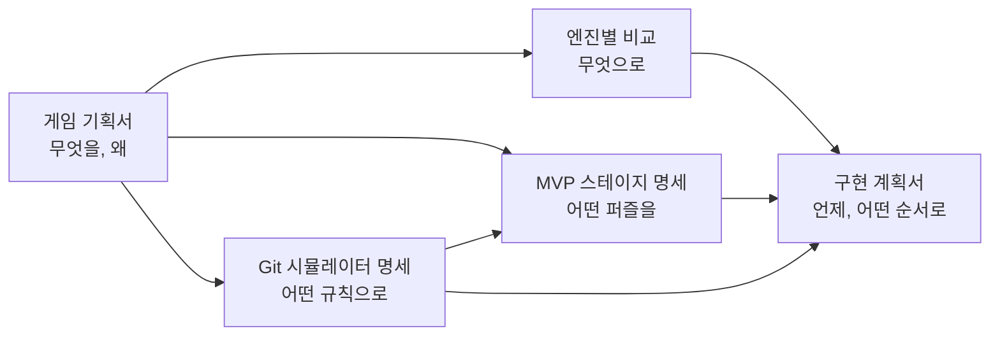

# 🛠️ 구현 계획서
### 「커밋 크래프트」 MVP 구현 계획 v1.0

> 목표: **한 학기(약 20주) 안에 실제 교실에서 시범 수업이 가능한 MVP**를 만든다.
> 원칙: **비싼 것(코드·아트)을 만들기 전에 싼 것(종이·테스트)으로 먼저 검증한다.**

---

## 0. 전제 (확정 필요 — 9장 참조)

| 항목 | 가정 |
|---|---|
| **실행 환경 (확정)** | **Windows PC (학교 컴퓨터실), Edge·Chrome** — [Windows 실행 환경 명세](WINDOWS_ENVIRONMENT.md) |
| 엔진 | Web (TypeScript) — [엔진별 비교](ENGINE_COMPARISON.md) 1안, Windows 전용 기준으로 재검토해도 동일 |
| 개발 인원 | 개발 1~2명 + 기획·교육(교사) 1명, AI 코딩 도구 활용 |
| 첫 사용처 | 1개 학교 1~2개 학급 시범 수업 |
| 범위 | 프롤로그 + 챕터 1~5 (34 스테이지, 싱글 + NPC 협업) — [MVP 스테이지 명세](STAGE_SPEC_MVP.md) |
| 기준 문서 | [Git 시뮬레이터 명세](GIT_SIMULATOR_SPEC.md) |

---

## 1. 시간이 오래 걸리는 곳 (그리고 대응)

| 순위 | 시간 잡아먹는 곳 | 왜 오래 걸리나 | 대응 |
|---|---|---|---|
| 1 | **Git 시뮬레이터 정확성** | 병합·충돌·push 규칙 하나만 틀려도 오개념을 가르침. 나중에 발견하면 스테이지 전부 재검증 | 명세를 실제 Git으로 이미 확인함. 코드보다 **테스트 벡터를 먼저** 작성. 실제 Git 대조 테스트를 CI에 넣음 |
| 2 | **스테이지 제작 (34개)** | 스테이지마다 초기 상태·판정·힌트·대안 해답 필요. 수작업 검증은 끝이 없음 | 데이터(JSON)만으로 스테이지 제작. **모범 해답 자동 클리어 검증**을 CI에서 실행 |
| 3 | 아트·연출 | 끝없이 다듬게 됨 | 버티컬 슬라이스에서 아트 기준 1회 확정 후 **복제만**. 연출 목록 고정 |
| 4 | 멀티플레이 | 서버·동기화·교실 네트워크 변수 | **MVP에서 제외.** NPC 동료로 대체 (시뮬레이터가 이미 NPC를 진짜 사용자처럼 처리) |
| 5 | 교사 대시보드 | 계정·개인정보·서버 필요 | MVP는 **진도 코드**(문자열 복사)만. 서버 없음 |
| 6 | 범위 확장 유혹 | "이것도 넣자"가 계속 생김 | 4장 MoSCoW 고정. 새 아이디어는 `백로그`에만 기록 |

---

## 2. 단계별 로드맵 (게이트 방식)

> 각 단계 끝에 **통과 기준(게이트)** 이 있다. 통과 못 하면 다음 단계로 가지 않고, 원인을 고치거나 범위를 줄인다.

```mermaid
gantt
    title MVP 로드맵 (1인 풀타임 기준, 주 단위)
    dateFormat  X
    axisFormat  %s주
    section 검증
    P0 기술 스파이크            :p0, 0, 1
    P2 종이 프로토타입          :p2, 1, 2
    section 코어
    P1 Git 코어 + 테스트        :p1, 1, 4
    section 게임
    P3 버티컬 슬라이스(챕터1)   :p3, 4, 8
    P4 콘텐츠 양산(챕터2~5)     :p4, 8, 12
    section 출시
    P5 QA·교사 자료             :p5, 12, 14
    P6 시범 수업·개선           :p6, 14, 17
    버퍼(15%)                  :buf, 17, 20
```



### P0. 기술 스파이크 (1주)
가장 위험한 기술 질문을 먼저 확인한다. 결과물은 버려도 되는 코드.
| 검증 항목 | 통과 기준 |
|---|---|
| 한글 입력 (커밋 메시지·충돌 편집기) | Windows 한국어 IME + Edge·Chrome에서 조합 중 글자 깨짐·끝 글자 중복 입력 없음 |
| 한/영 전환 감지 | 한글 상태로 `git` 입력 시(`햣`) 안내 문구 표시 |
| 터미널 UI | 직접 만든 입력창(`<input>`) 방식으로 한글·화살표 히스토리·자동완성 동작, D2Coding 폰트로 정렬 유지 |
| 커밋 그래프 렌더 | 커밋 100개 그래프 SVG 렌더 60fps 근처, 내장 그래픽 저사양 PC 30fps 이상 |
| 학교 PC 실행 | 학교 컴퓨터실에서 GitHub Pages 주소 접속, 첫 로딩 10초 이내, 1366×768·배율 125%에서 잘림 없음 |
| 학교망 차단 | `*.github.io` 접속 가능 여부 확인 → 막히면 학교/교육청 도메인 또는 오프라인 단일 파일판 |
| 오프라인 단일 파일판 | HTML 1개를 `file://`로 열어 챕터 1 플레이 가능 |
| 복원 프로그램 | 재부팅 후 진도 코드로 이어하기 성공 |

> ⚠️ xterm.js 같은 터미널 라이브러리는 한글 조합 입력에 문제가 생길 수 있다. 입력은 브라우저 기본 입력창으로, 출력만 터미널 스타일로 그리는 방식을 기본으로 한다.

### P1. Git 코어 + 테스트 (3주, P2와 병행)
| 주 | 작업 |
|---|---|
| 1 | 데이터 모델, init/add/commit/status/log, 테스트 벡터 형식, **실제 Git 대조 테스트 도구** |
| 2 | branch/switch(이월 규칙)/checkout 별칭/restore/diff/show, merge(ff·3-way·diff3·충돌·abort) |
| 3 | revert, 허브·clone/remote/fetch/push/pull, NPC 스크립트, 입력 파서·오타 교정 |
- **게이트 G1**: 테스트 벡터 260개 이상 통과 + 실제 Git 대조 100% 일치 + 불변식 위반 0 + 명령 1개 처리 10ms 이내

### P2. 종이 프로토타입 (1주, P1과 병행)
코드 없이 **언플러그드 카드 버전**(GDD 12.4)으로 챕터 1·3·4·5 핵심 스테이지를 학생 5~8명과 진행.
- 확인할 것: 메타포(포장대, 크리스탈, 이름표, 우편함)가 통하는가? 어디서 막히는가? 어떤 힌트 문구가 먹히는가?
- **게이트 G2**: 학생 80% 이상이 "브랜치는 이름표", "commit ≠ push"를 자기 말로 설명. 실패한 메타포는 이 단계에서 교체 (코드 수정 비용 0)

### P3. 버티컬 슬라이스 — 챕터 1 완성 (4주)
챕터 1을 **최종 품질로** 완성한다. 이후 모든 챕터는 이 품질 기준을 복제한다.
| 구성 요소 | 포함 |
|---|---|
| 화면 | 마을 뷰(2D 아이소메트릭), 커밋 그래프(나무), 터미널, 포장대, **4개 공간 미니맵**, 깃토리 힌트 |
| 시스템 | 스테이지 로더(JSON), 목표 판정 DSL, 별점, 힌트 3단계, 되감기, 저장(브라우저 저장소 + 진도 코드) |
| 모드 | 하이브리드 / 터미널 |
| 도구 | 스테이지 JSON 검증기 + 자동 클리어 테스트 (CI) |
- **게이트 G3** (학생 플레이테스트 5명 이상)
  - 챕터 1 클리어율 80% 이상, 평균 40분 이내
  - 힌트 ③단계 사용률 스테이지당 30% 이하
  - "재미있었다" 5점 척도 평균 3.5 이상
  - 학교 PC에서 버그로 진행 불가 0건

### P4. 콘텐츠 양산 — 챕터 2~5 (4주)
| 주 | 작업 |
|---|---|
| 1 | 챕터 2 (5개) + 챕터 3 (6개) |
| 2 | 챕터 4 (7개) — 충돌 편집기(비주얼/텍스트) |
| 3 | 챕터 5 (8개) — 허브 섬 화면, NPC 연출, 우편함(origin/main) 시각화 |
| 4 | 프롤로그, 퀴즈·진단 문항, 전체 연결 플레이 |
- 스테이지 1개 완료 정의(DoD)는 5장.
- **게이트 G4**: 34개 스테이지 전부 CI 자동 검증 통과 + 처음부터 끝까지 통과 플레이 3회 (각자 다른 사람)

### P5. QA·교사 자료 (2주)
- Windows 테스트 매트릭스 9종 ([Windows 실행 환경 명세 6장](WINDOWS_ENVIRONMENT.md#6-테스트-매트릭스-p0p5에서-사용))
- 접근성 점검 (색약 모드, 글자 크기, 키보드 전용)
- 교사 가이드, 차시별 슬라이드, 사전·사후 진단지, 실제 Git for Windows 설치·설정 안내(에필로그), 공용 PC 로그인 정리 체크리스트
- **게이트 G5**: 치명 버그 0, 주요 버그 3건 이하, 교사 1명이 가이드만 보고 수업 리허설 성공

### P6. 시범 수업·개선 (3주)
- 4차시 수업 (GDD 15.1), 사전·사후 진단, 플레이 로그(진도 코드) 수집
- **성공 기준 (KPI)**
| 지표 | 목표 |
|---|---|
| 사전→사후 진단 정답률 | +30%p 이상 |
| 핵심 오개념 3문항(commit≠push, 브랜치=이름표, pull=fetch+merge) 사후 정답률 | 80% 이상 |
| 4차시 내 챕터 1~5 클리어율 | 70% 이상 |
| 만족도 | 평균 4.0/5 이상 |

### 버퍼 (3주, 전체의 약 15%)
예상 못 한 일정 지연용. 쓰지 않으면 2차 범위(챕터 6) 착수.

### 인력 조건에 따른 기간
| 조건 | 예상 기간 |
|---|---|
| 1인 풀타임 | 약 20주 (버퍼 포함) |
| 2인 풀타임 | 약 13~14주 (P1과 P3 일부 병행) |
| 교사 파트타임 (주 10시간) + AI 코딩 도구 | 약 1년 → **범위를 챕터 1~4로 줄이는 것을 권장** |

---

## 3. 저장소 구조 & 개발 방식

```
/
├─ packages/
│  ├─ git-core/        # 순수 TS. DOM·브라우저 API 사용 금지
│  ├─ stage-kit/       # 스테이지 스키마, 판정 DSL, 검증기, 자동 클리어 러너
│  └─ hub-sim/         # (2차) PR·Fork·리뷰
├─ content/
│  ├─ stages/          # 1-1.json ... 5-B.json
│  └─ i18n/ko.json     # 대사·힌트·해설 (코드와 분리)
├─ apps/
│  └─ game/            # React + Vite 앱 (마을/그래프/터미널/UI)
├─ tools/
│  └─ difftest/        # 실제 git 대조 테스트 (Node, CI 전용)
├─ docs/               # 기획 문서
└─ .github/workflows/  # CI: lint → test → difftest → stage-verify → build → Pages 배포
```

| 항목 | 선택 |
|---|---|
| 언어/빌드 | TypeScript (strict), Vite |
| UI | React |
| 마을 렌더 | SVG 또는 Canvas 2D (Phaser는 연출 요구가 커질 때만) |
| 그래프 | SVG (레이아웃은 직접 구현: 브랜치별 열 배치) |
| 테스트 | Vitest + 테스트 벡터 JSON |
| 저장 | 브라우저 저장소 (실패해도 동작하도록 예외 처리) + 진도 코드 |
| 배포 | GitHub Pages (학교망 차단 시 대체 호스팅) |

### 개발 방식 = 게임이 가르치는 방식 그대로
- `main` 보호, 기능마다 `feature/*` 브랜치, **Pull Request + 리뷰 후 병합**
- 커밋 메시지 규칙은 게임의 0.4 규칙과 동일하게
- → 개발 저장소 자체를 나중에 **수업 예시 자료**로 쓸 수 있다

---

## 4. 범위 고정 (MoSCoW)

| 등급 | 항목 |
|---|---|
| **Must** (MVP 필수) | 시뮬레이터 명세의 MVP 명령 전부 · 34 스테이지 · 4개 공간 미니맵 · 커밋 그래프 · 하이브리드/터미널 모드 · 힌트 3단계 · 별점 · 충돌 편집기(비주얼+텍스트) · NPC 동료 · 진도 코드(복원 프로그램 대응) · 오프라인 단일 파일판 · 한/영 전환 감지 · 한국어 · 색약 대응 · 키보드 조작 |
| **Should** (여유 있으면) | 비주얼 전용 모드(터미널 숨김) · 되감기 UI · 효과음 · 깃토리 애니메이션 · 교사용 정답 리플레이 |
| **Could** (2차) | 챕터 6(PR·리뷰·Fork) · 챕터 7(심화) · 교사 대시보드 서버 · 실시간 2인 협업 · 영어 · 태블릿 블록 터미널 · 스테이지 에디터 |
| **Won't** (이번엔 안 함) | 3D · Unity/Unreal/Godot 포팅 · 크롬북·태블릿·모바일 대응 · macOS 전용 대응 · 계정 시스템 · 앱스토어 출시 · AI 튜터 · 실제 GitHub API 연동 |

### 일정이 밀릴 때 자르는 순서 (미리 정해둠)
1. Should 항목 전부
2. 마을 연출을 아이콘 수준으로 단순화
3. 챕터 2의 2-2(비교 렌즈) → 이후 챕터 해설로 대체
4. 5-7(연결선) → 에필로그 실습으로 이동
5. 챕터 5 보스를 단순화 (충돌 1회만)

### 절대 자르지 않는 것
- 시뮬레이터 정확성 · 실제 Git 대조 테스트
- 4개 공간 미니맵 · 커밋 그래프
- 3-1(브랜치=이름표), 4-3(충돌), 5-3(commit≠push), 5-4(fetch), 5-6(push 거절)

---

## 5. 완료 정의 (Definition of Done)

### 5.1 Git 명령 1개
- [ ] 시뮬레이터 명세의 모든 경우(성공·오류)가 테스트 벡터로 있음
- [ ] 실제 Git 대조 테스트 통과
- [ ] 오류 코드별 깃토리 해설 문구 있음
- [ ] 이벤트 발행 → 그래프·마을·미니맵 연출 연결됨

### 5.2 스테이지 1개
- [ ] 스테이지 명세 카드의 모든 필드가 JSON에 있음
- [ ] CI: 스키마·불변식·모범 해답·허용 대안·실패 해답 검증 통과
- [ ] 하이브리드·터미널 두 모드 모두 클리어 확인
- [ ] 힌트 3단계 + 오개념 태그 + 예상 시간
- [ ] 맞춤법·말투 검토 (고등학생 대상, 반말 멘토 톤 통일)
- [ ] 1명 이상 사람 플레이 확인

### 5.3 릴리스
- [ ] 게이트 기준 충족
- [ ] 기기별 테스트 표 작성
- [ ] 알려진 차이 목록(시뮬레이터 명세 부록 B) 공개

---

## 6. 품질 기준 (숫자로)

| 항목 | 기준 |
|---|---|
| 첫 로딩 (학교 PC) | 10초 이내, 전송량 5MB 이하 |
| 명령 실행 → 화면 반응 | 100ms 이내 |
| 프레임 | 저사양 30fps 이상 |
| 저장 | 스테이지 클리어마다 자동 저장. 저장 실패해도 게임 진행 가능 |
| 실행 환경 | Windows 10/11, Edge·Chrome 최신 2버전, 1366×768 이상 |
| 접근성 | 색만으로 정보 전달 금지, 글자 대비 4.5:1 이상, 전체 키보드 조작 |

---

## 7. 리스크 조기 경보

| 신호 | 의미 | 조치 |
|---|---|---|
| P1 2주차에 대조 테스트 불일치가 계속 나옴 | 병합 구현이 어긋남 | diff3 검증된 구현 채택, 해당 영역 벡터 추가 |
| G2에서 특정 메타포가 안 통함 | 개념 설계 문제 | 코드 착수 전 메타포 교체 (가장 쌈) |
| G3 클리어율 60% 미만 | 난이도·안내 문제 | 스테이지 분할(새 개념 1개 원칙 재점검), 힌트 문구 개선 |
| 스테이지 1개 제작에 2일 이상 | 도구 부족 | 스테이지 JSON 작성 도우미(초기 상태 기록 기능) 추가 |
| 학교 PC에서 로딩 15초 이상 | 용량·성능 | 에셋 압축, 지연 로딩, 2D 단순화 |

---

## 8. 문서 간 관계


- 충돌 시 우선순위: **시뮬레이터 명세(실제 Git 동작) > 스테이지 명세 > 게임 기획서**
  (재미를 위해 Git 동작을 바꾸지 않는다. 대신 스테이지 설계를 바꾼다.)

---

## 9. 착수 전 결정이 필요한 것

| # | 질문 | 기본값(답이 없으면) |
|---|---|---|
| 1 | 누가 개발하나? (교사 본인 / 학생 동아리 / 외주) | 교사 + AI 코딩 도구 |
| 2 | 시범 수업 목표 시기는? | 다음 학기 |
| 3 | 엔진은 Web으로 확정? | Web |
| 4 | ~~대상 학교 기기 구성~~ | ✅ **확정: Windows PC** |
| 4-1 | 컴퓨터실에 PC 복원 프로그램이 있나? Git for Windows를 기본 이미지에 넣을 수 있나? | 복원 프로그램 있음으로 가정, Git은 PortableGit 대비 |
| 5 | `*.github.io` 접속이 학교망에서 되나? | P0에서 확인 |
| 6 | 아트: 직접 제작 / 무료 에셋 / 외주 | 무료 에셋(라이선스 확인) + 단순 도형 |
| 7 | 학생 개인정보: 닉네임만 / 학번 연동 | 닉네임만 (서버 저장 없음) |
