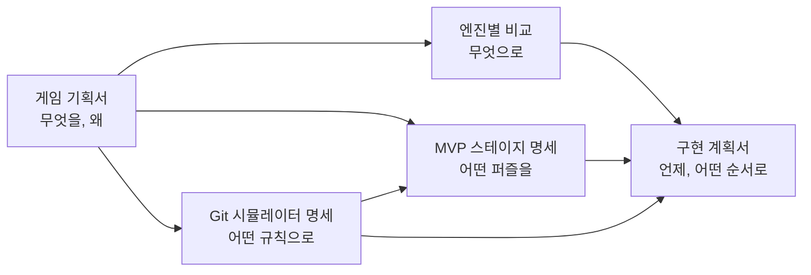

# 🛠️ 구현 계획서
### 「커밋 크래프트」 MVP 구현 계획 v1.1 (2026-11-03 기획 점검 반영)

> 목표: **4차시 필수 경로 20개로 친구와 협업하는 시범 수업이 가능한 첫 MVP**를 만든다. 전체 34개는 확장 MVP로 유지한다. 24주는 1인 풀타임의 기존 전체 범위 초기 추정이며 확정 납기가 아니다.
> 원칙: **비싼 것(코드·아트)을 만들기 전에 싼 것(종이·테스트)으로 먼저 검증한다.**

---

## 0. 전제 (확정 필요 — 9장 참조)

| 항목 | 가정 |
|---|---|
| **실행 환경 (확정)** | **Windows PC (학교 컴퓨터실), exe 또는 Edge·Chrome 웹판** — [Windows 실행 환경 명세](WINDOWS_ENVIRONMENT.md) |
| **엔진 (확정)** | **Godot 4.7.2 + GDScript** — [Godot 아키텍처](GODOT_ARCHITECTURE.md). 배포 후보: Windows exe / 웹 내보내기(Edge/Chrome). 첫 시범은 P0에서 1종 선정 |
| 개발 인원 | 미확정. 교사 + AI 도구를 작업 가정으로 두되 실제 개발자·교육 담당·서버 운영자와 각자의 주당 시간을 P0에서 기록. AI는 개발 인원이나 검증 시간 대체로 계산하지 않음 |
| 첫 사용처 | 1개 학교 1~2개 학급 시범 수업 |
| 범위 | 첫 시범: [필수 경로 20개](STAGE_SPEC_MVP.md#부록-c-4차시-필수-경로-20개-게임-시간-140분-예산), 2인 온라인 + NPC 대체, 선정한 배포·서버 조합. 확장 MVP: 프롤로그 + 챕터 1~5 전체 34개 |
| 기준 문서 | [Git 시뮬레이터 명세](GIT_SIMULATOR_SPEC.md) |

---

## 1. 시간이 오래 걸리는 곳 (그리고 대응)

| 순위 | 시간 잡아먹는 곳 | 왜 오래 걸리나 | 대응 |
|---|---|---|---|
| 1 | **Git 시뮬레이터 정확성** | 병합·충돌·push 규칙 하나만 틀려도 오개념을 가르침. 나중에 발견하면 스테이지 전부 재검증 | 명세를 실제 Git으로 이미 확인함. 코드보다 **테스트 벡터를 먼저** 작성. 실제 Git 대조 테스트를 CI에 넣음 |
| 2 | **스테이지 제작 (첫 시범 20개 / 전체 34개)** | 스테이지마다 초기 상태·판정·힌트·대안 해답 필요. 수작업 검증은 끝이 없음 | 데이터(JSON)만으로 스테이지 제작. **모범 해답 자동 클리어 검증**을 CI에서 실행 |
| 3 | 아트·연출 | 끝없이 다듬게 됨 | 버티컬 슬라이스에서 아트 기준 1회 확정 후 **복제만**. 연출 목록 고정 |
| 4 | 멀티플레이 | 서버·교실 네트워크 변수 | **MVP에 포함하되 단순하게**: Git처럼 push/fetch 할 때만 통신(실시간 동기화 없음), 서버는 허브 저장소만 관리, 실패 시 NPC 대체 — [협업 설계](MULTIPLAYER_DESIGN.md) |
| 5 | 교사 운영 기능 | 방·승인·단계 진행·개인별 체험 확인 필요 | MVP는 입장·팀·단계·완료 확인·CSV만. 서버는 협업용으로 필요하며 고급 통계·리플레이는 후속 범위 |
| 6 | 범위 확장 유혹 | "이것도 넣자"가 계속 생김 | 4장 MoSCoW 고정. 새 아이디어는 `백로그`에만 기록 |

---

## 2. 단계별 로드맵 (게이트 방식)

> 각 단계 끝에 **통과 기준(게이트)** 이 있다. 통과 못 하면다음 단계로 가지 않고 원인을 고치거나 범위를 줄인다.
> 아래 주차 도표는 **기존 34개 전체 범위·1인 풀타임의 참고 추정**이다. 첫 시범용 20개를 P3→P4에서 먼저 제작한다. P0에서 실제 주당 시간과 검증 환경을 확보하고 P2 결과로 첫 시범·전체 34개·후속 배포 조합의 작업량과 날짜를 각각 다시 산정한다. 확정 전 다음 학기를 납기로 약속하지 않는다.

```mermaid
gantt
    title MVP 로드맵 (1인 풀타임 기준, 주 단위)
    dateFormat  X
    axisFormat  %s주
    section 검증
    P0 기술 스파이크            :p0, 0, 1
    P2 종이 프로토타입          :p2, 1, 2
    section 코어
    P1 Git 코어 + 테스트        :p1, 1, 4
    P1.5 협업 네트워크          :p15, 4, 6
    section 게임
    P3 버티컬 슬라이스(챕터1)   :p3, 6, 10
    P4 필수경로 우선·전체 콘텐츠     :p4, 10, 15
    section 출시
    P5 QA·교실 부하시험·교사자료 :p5, 15, 17
    P6 시범 수업·개선           :p6, 17, 20
    버퍼(4주)                  :buf, 20, 24
```



### P0. 기술 스파이크 (1주)
가장 위험한 기술 질문을 먼저 확인한다. 결과물은 버려도 되는 코드. **스파이크 화면은 이미 작성됨: `game/scenes/spike/`** (실행 방법: `game/README.md`)
| 검증 항목 | 통과 기준 | Windows exe | 웹 내보내기 |
|---|---|:---:|:---:|
| 한글 입력 (커밋 메시지·충돌 편집기) | Windows 한국어 IME에서 조합 중 글자 깨짐·끝 글자 중복 없음 (스파이크 ① 탭 기록으로 확인) | ☐ | ☐ |
| 한/영 전환 감지 | 한글 상태로 `git` 입력 시(`햣`) 안내 문구 표시 (스파이크 ② 탭) | ☐ | ☐ |
| 터미널 UI | `LineEdit` 입력 + `RichTextLabel` 출력, ↑↓ 기록, 고정폭 글꼴 정렬 | ☐ | ☐ |
| 커밋 그래프 렌더 | 커밋 100개 `_draw()` 그래프, 부하 시험에서 내장 그래픽 PC 30fps 이상 (스파이크 ③ 탭) | ☐ | ☐ |
| 학교 PC 실행 | exe: 공유 폴더에서 더블클릭 실행(차단·"PC 보호" 경고 확인) / 웹: Edge 접속 후 첫 로딩 20초 이내 | ☐ | ☐ |
| 화면 | 1366×768·배율 125%에서 잘림 없음 | ☐ | ☐ |
| 웹 용량 | 압축 전송 20MB 이하 (엔진 파일 포함 실측) | — | ☐ |
| 학교망 차단 | `*.github.io` 또는 교내 서버 접속 가능 여부 | — | ☐ |
| 복원 프로그램 | 재부팅 후 진도 코드로 이어하기 성공 | ☐ | ☐ |
| **교실 네트워크** (스파이크 ④ 탭) | 선생님 PC 서버 열기 + 학생 PC 3대 접속·알림 주고받기 (방화벽·교내망 차단 확인) | ☐ | — (웹판은 인터넷 서버로만) |

> P0 기록 필수: 개발자·교육 담당·서버 운영 담당, 각자의 주당 실제 작업 시간, 사용할 학교·검증 PC, 배포 1종, 서버 1종, 예상 작업 시간 및 재산정한 시범 일정. 기본 검증 후보는 exe + 교실 서버 + 2인 팀이며 P0 통과 전 확정하지 않는다.
> 위 표는 배포 후보 조사표다. 첫 시범은 선택 조합만 릴리스 게이트로 삼고 다른 조합은 후속 검증으로 표시한다. 웹을 선택하면 인터넷 서버가 필요하다. exe·웹 또는 A·B를 모두 지원해야 첫 시범이 가능하다는 요구는 두지 않는다. 선택 조합이 실행 불가면 재선정·재검증하고, NPC 수업만 가능하면 온라인 게이트 미달로 보고한다.

### P1. Git 코어 + 테스트 (3주, P2와 병행)
| 주 | 작업 |
|---|---|
| 1 | 데이터 모델, init/add/commit/status/log, 테스트 벡터 형식, **실제 Git 대조 테스트 도구** |
| 2 | branch/switch(이월 규칙)/checkout 별칭/restore/diff/show, merge(ff·3-way·diff3·충돌·abort) |
| 3 | revert, 허브·clone/remote/fetch/push/pull, NPC 스크립트, 입력 파서·오타 교정 |
- 필수 스냅샷 벡터: 수정→add→재수정→commit 시 index 내용이 커밋되고 worktree의 재수정은 남음. 다시 add하면 최신 내용이 커밋됨. 실제 Git과 두 경로를 대조한다.
- **게이트 G1**: 테스트 벡터 260개 이상 통과 + 실제 Git 대조 100% 일치 + 불변식 위반 0 + 명령 1개 처리 10ms 이내

### P1.5. 협업 네트워크 (2주) — [협업 설계](MULTIPLAYER_DESIGN.md)
| 주 | 작업 |
|---|---|
| 1 | fetch/push 규약, 서버 팀 허브, 시뮬레이터와 동일한 조상 판정·원자적 참조 교체, 선정한 서버 실행 방식 |
| 2 | 방 코드·팀, 재접속, 연결 끊김 처리, 팀원 부재 시 NPC 대체, 서버 자동 저장·복구 |
- **게이트 G1.5**: 가상 학생 30명 통신·팀 분리 검증, 같은 기준에서 갈라진 두 tip의 동시 push는 1명만 성공. 5-6 두 라운드에서 두 학생 각각 거절·복구, 5-B 두 라운드에서 두 학생 각각 충돌 편집·해결을 실제 이벤트로 확인.
- 선행 push/fetch/pull, 지연·중복 준비, push 응답 유실, 해결 중 재접속, NPC 인계·복귀를 검증한다. 서버 재시작 후 허브·라운드·개인 체험을 함께 복구하고 수업 종료 시 임시 사본을 삭제한다. 위 작업을 2주 내 확정 가능하다고 간주하지 않고 P0/P2 후 재견적한다.
- 단독 각본 NPC와 협업 역할 대체 NPC의 예상 오류 규칙을 분리해 검증한다. 역할 대체의 의도된 거절·충돌·복구는 허용하고 NPC 체험을 이탈 학생에게 귀속하지 않는다.

### P2. 종이 프로토타입 (1주, P1과 병행)
코드 없이 **언플러그드 카드 버전**(GDD 12.4)으로 챕터 1·3·4·5 핵심 스테이지를 학생 5~8명과 진행.
- 확인할 것: 메타포가 통하는가, 어디서 막히는가, 어떤 힌트가 먹히는가. add 후 재수정한 건물의 봉인 결과를 예측하게 한다.
- **재미 관찰 기록**: 학생별 선택 이유, 지시 없이 비교/실험한 횟수, 실패 뒤 자발적 재시도, 자기 마을을 남에게 보여주려는 행동, 대기 시간·이탈 이유를 기록한다. 힌트·조회·정답 시도 횟수로 재미를 대체하지 않는다.
- 똑같은 학습 목표에서 안내 중심 과제와 색·장식 선택을 포함한 과제를 순서를 바꿔 경험시킨다. 종이 실험의 결과는 디지털 재미의 증명이 아닌 수정 근거로 사용한다.
- **게이트 G2**: 학생 80% 이상이 "브랜치는 이름표", "commit ≠ push", "add 시점 내용이 커밋됨"을 자기 말로 설명. 실패한 메타포는 이 단계에서 교체.
- 5~8명 중 과반이 선택 이유를 말하지 못하거나 지시가 없으면 실험·재시도를 전혀 하지 않으면, 보상·대사 추가보다 선택과 결과의 연결을 고친 후 재검증한다. 이는 소규모 탐색 기준이며 효과 입증 통계로 보고하지 않는다.

### P3. 버티컬 슬라이스 — 챕터 1 완성 (4주)
챕터 1을 **최종 품질로** 완성한다. 이후 모든 챕터는 이 품질 기준을 복제한다.
| 구성 요소 | 포함 |
|---|---|
| 화면 | 마을 뷰(3D 모델 + 고정 정사영 쿼터뷰), 커밋 그래프(나무), 터미널, 포장대, **4개 공간 미니맵**, 깃토리 힌트 |
| 시스템 | 스테이지 로더(JSON), 목표 판정 DSL, 별점, 힌트 3단계, 되감기, 저장(브라우저 저장소 + 진도 코드) |
| 모드 | 하이브리드 / 터미널 |
| 도구 | 스테이지 JSON 검증기 + 자동 클리어 테스트 (CI) |
- **게이트 G3** (학생 플레이테스트 5명 이상)
  - 챕터 1 클리어율 80% 이상, 평균 40분 이내
  - 힌트 사용률은 지원 필요 지표로만 기록. 도움 후 다른 예의 스냅샷 결과를 80% 이상 설명할 수 있어야 함
  - "재미있었다" 평균 3.5/5 이상 + 학생별 선택·실험·자발적 재시도·공유 의사 관찰. 과반이 선택과 결과를 연결하지 못하거나 지시 반복만 하면 콘텐츠 양산을 보류하고 과제를 수정
  - 필수 경로 1차시의 게임 시간 35분 예산을 실제 소요·대기·힌트 시간 포함해 확인. 넘으면 전체 경로 시간과 안내를 재조정
  - 학교 PC에서 버그로 진행 불가 0건

### P4. 필수 경로 우선 제작 → 전체 34개 확장 (기존 초기 추정 5주)
| 주 | 작업 |
|---|---|
| 1 | 챕터 2 (5개) + 챕터 3 (6개) |
| 2 | 챕터 4 (7개) — 충돌 편집기(비주얼/텍스트) |
| 3 | 챕터 5 (8개) — 허브 섬 화면, NPC 연출, 우편함(origin/main) 시각화 |
| 4 | 필수 경로 20개 연결, 퀴즈·진단 문항, 5-6 역할 교대 시간 확인 |
| 5 | 선택 스테이지 연결, 5-B 개인별 충돌 해결, 전체 34개 확장 검증 |
- 스테이지 1개 완료 정의(DoD)는 5장.
- **게이트 G4-시범**: 필수 20개 스테이지 CI 통과(모범·대안·실패 해답), 독립 fixture로 생략 구간 건너뛰기, 조회·오류·힌트 비감점, 1-4 index/worktree 구분, 5-6 개인별 거절 및 팀 완료 검증. 필수 경로 연결 플레이 3회(서로 다른 사람).
- **게이트 G4-확장**: 나머지 14개를 포함한 전체 34개 CI 통과 + 5-B 개인별 해결 + 전체 연결 플레이 3회. 첫 시범과 별도로 판정하며 미제작 선택 스테이지를 완료로 표시하지 않는다.

### P5. QA·교사 자료 (2주)
- 선정한 배포·서버 조합에 적용되는 Windows 테스트 매트릭스 항목 ([Windows 실행 환경 명세 6장](WINDOWS_ENVIRONMENT.md#6-테스트-매트릭스-p0p5에서-사용))
- 접근성 점검 (색약 모드, 글자 크기, 키보드 전용)
- 교사 가이드, 차시별 슬라이드, 사전·사후 진단지, 실제 Git for Windows 설치·설정 안내(에필로그), 공용 PC 로그인 정리 체크리스트
- **게이트 G5**: 치명 버그 0, 주요 버그 3건 이하, 교사 1명이 가이드만 보고 필수 경로 리허설 성공. 차시별 게임 35분 + 운영·평가 15분 예산을 확인하고 초과 시 안내·전환을 수정하거나 차시를 늘린다. 힌트·개인별 체험을 생략해 맞추지 않는다.

### P6. 시범 수업·개선 (3주)
- 4차시 수업 (GDD 15.1), 사전·사후 진단, 플레이 로그(진도 코드) 수집
- **성공 기준 (KPI)**
| 지표 | 목표 |
|---|---|
| 사전→사후 진단 정답률 | +30%p 이상 |
| 핵심 오개념 3문항(commit≠push, 브랜치=이름표, pull=fetch+merge) 사후 정답률 | 80% 이상 |
| 4차시 내 필수 경로 20개 개인 완료율 | 70% 이상 (온라인/NPC 모드별 인원·소요 시간 별도 보고) |
| 만족도 | 평균 4.0/5 이상 |
| 사람 간 협업 검증 | 참여한 온라인 짝의 두 학생 각각 거절·복구 체험. NPC 대체는 학습 완료로 인정하되 사람 간 협업 성공 건수에는 합산하지 않음 |
| 실제 이해 전이 | 도움 사용 여부와 별개로 새 파일·그래프 사례의 결과 예측 및 이유 설명을 사후 진단에 포함 |

### 버퍼 (기존 참고 도표 4주, 전체 24주의 약 17%)
예상 못 한 일정 지연용. 쓰지 않으면 2차 범위(챕터 6) 착수.

### 인력 조건에 따른 기간
| 조건 | 예상 기간 |
|---|---|
| 1인 풀타임 | 주 40시간 가정. 기존 전체 범위 약 24주(960시간) 초기 추정. 수정된 협업·검증 범위로 재산정 필요 |
| 2인 풀타임 | 기존 약 15~16주 초기 추정. 역할 분담과 학교 검증 시간을 확보한 뒤 재산정 |
| 교사 파트타임 (주 10시간) + AI 코딩 도구 | 960시간을 단순 환산하면 96주(휴업·학교 일정 제외). 기존 약 1년 추정은 근거 부족으로 철회. 첫 20개 경로의 작업 시간을 별도 추정해 일정 확정 |

---

## 3. 저장소 구조 & 개발 방식

```
/
├─ game/               # Godot 4.7 프로젝트 (상세: GODOT_ARCHITECTURE.md 3장)
│  ├─ core/            # 순수 로직 — Git 시뮬레이터, 건물 파일, 진도 코드, 한/영 감지 (Node 금지)
│  ├─ stage/           # 스테이지 로더, 판정 DSL, 힌트, 별점 (Node 금지)
│  ├─ content/         # stages/*.json, text/ko.json
│  ├─ scenes/          # 화면: 마을·그래프·터미널·포장대·미니맵·충돌 편집기
│  └─ tests/           # 헤드리스 테스트, 테스트 벡터
├─ tools/
│  └─ difftest/        # 실제 git 대조 테스트 (Python, CI 전용)
├─ docs/               # 기획 문서
└─ .github/workflows/  # CI: 헤드리스 테스트 → difftest → 스테이지 자동 검증 → 내보내기
```

| 항목 | 선택 |
|---|---|
| 엔진·언어 | Godot 4.7.2, GDScript (정적 타입 필수) |
| 렌더러 | Compatibility |
| UI | Control 노드 (화면 구성은 가능하면 코드로) |
| 마을 렌더 | `Node3D` + 고정 정사영 `Camera3D` 쿼터뷰. 로컬 모델이 없으면 색상 도형으로 대체. [마을 설계](superpowers/specs/2026-11-03-village-view-design.md) 기준이며 현재는 P0 시안만 구현 |
| 그래프 | `Control._draw()` (브랜치별 세로 줄 배치 직접 구현) |
| 테스트 | 자체 헤드리스 실행기(`tests/run_tests.gd`) + 테스트 벡터 JSON |
| 저장 | `user://` (실패해도 동작) + 진도 코드 |
| 배포 | 첫 시범은 P0 선정 1종, 다른 조합은 후속. exe 및 웹 내보내기 설계는 유지 |

### 개발 방식 = 게임이 가르치는 방식 그대로
- `main` 보호, 기능마다 `feature/*` 브랜치, **Pull Request + 리뷰 후 병합**
- 개발 저장소의 커밋 메시지는 변경 대상과 목적을 명확히 쓴다. 게임 0.4의 건물·구역 이름 조건은 게임 콘텐츠 전용이며 개발 커밋에 강제하지 않는다
- → 개발 저장소 자체를 나중에 **수업 예시 자료**로 쓸 수 있다

---

## 4. 범위 고정 (MoSCoW)

| 등급 | 항목 |
|---|---|
| **Must** (첫 시범 필수) | 명세의 필수 경로용 Git 동작 · 필수 20개 · 4개 공간·커밋 그래프 · 하이브리드/터미널 · 힌트 3단계(비감점) · 별점 공통 집계 · 충돌 편집기 · 2인 온라인 협업(선정한 서버 1종, 방·팀·승인·진행·개인 완료 확인) · NPC 대체 · 진도 코드 · 선정 배포 1종 · 한/영 감지 · 한국어 · 색약·키보드 대응 |
| **Should** (확장 MVP) | 나머지 14개를 포함한 전체 34개 · 시뮬레이터 MVP 명령 전부 · 선택하지 않은 exe/웹 및 서버 조합(각각 별도 검증) · 되감기 UI · 효과음 · 깃토리 애니메이션 · 정답 리플레이 |
| **Could** (2차) | 챕터 6(PR·리뷰·Fork) · 챕터 7(심화) · 3~4인 팀 · 비주얼 전용 모드 · 고급 현황판(리플레이·통계) · 학급 허브 · 영어 · 태블릿 · 스테이지 에디터 |
| **Won't** (이번엔 안 함) | 마을 쿼터뷰 외 3D 확장(자유 카메라·캐릭터·군중 등) · 다른 엔진 포팅 · C# · 크롬북·모바일 · macOS 전용 대응 · 계정 시스템 · 앱스토어 · AI 튜터 · 실제 GitHub API 연동 |

첫 시범에도 실제 Git과의 불일치를 허용하지 않는다. P1 코어 게이트는 전체 명세를 기준으로 유지하고, 콘텐츠 제작·배포 조합의 우선순위를 줄인다. 미지원 항목은 안내하며 동작을 꾸며내지 않는다.

마을 한정 3D 표현은 허용하며 Git 코어와 나머지 UI는 기존 구조를 유지한다. 정식 마을의 상태 연동·결정적 가변 배치·선택 처리는 후속 구현이고, P0 시안의 실행 성공으로 완료 처리하지 않는다. [P0 검증 기록](P0_VALIDATION.md)에 로컬 자동 검증과 학교 현장 검증을 분리해 기록한다.

### 일정이 밀릴 때 자르는 순서 (필수 경로 유지)
1. 첫 시범에 선택하지 않은 배포·서버 조합과 연출·되감기·리플레이를 후속 일정으로 이동.
2. 나머지 14개 선택 스테이지의 완성을 확장 MVP로 이동. 기존 34개 카드는 삭제하지 않는다.
3. 마을 연출을 아이콘 수준으로 단순화하되 선택과 기록 결과의 관계는 유지.
4. 그래도 초과하면 시범 날짜 또는 차시 수를 조정하고 변경 범위를 문서에 기록. 필수 경로를 줄이면 성취 목표·KPI도 함께 재승인하며 조용히 제외하지 않는다.

### 절대 자르지 않는 것
- 시뮬레이터 정확성 · 실제 Git 대조 테스트
- 4개 공간 미니맵 · 커밋 그래프
- 1-4(add 시점 스냅샷), 3-1(브랜치=이름표), 4-3·4-4(충돌), 5-3(commit≠push), 5-4(fetch), 5-6(개인별 push 거절) 및 해당 조회·힌트·체험 시간

---

## 5. 완료 정의 (Definition of Done)

### 5.1 Git 명령 1개
- [ ] 시뮬레이터 명세의 모든 경우(성공·오류)가 테스트 벡터로 있음
- [ ] 실제 Git 대조 테스트 통과
- [ ] 오류 코드별 깃토리 해설 문구 있음
- [ ] 이벤트 발행 → 그래프·마을·미니맵 연출 연결됨

### 5.2 스테이지 1개
- [ ] 스테이지 명세 카드의 모든 필드가 JSON에 있음
- [ ] CI: 스키마·불변식·모범 해답·허용 대안·실패 해답 검증 통과
- [ ] 하이브리드·터미널 두 모드 모두 클리어 확인
- [ ] 힌트 3단계 + 오개념 태그 + 예상 시간
- [ ] 맞춤법·말투 검토 (고등학생 대상, 반말 멘토 톤 통일)
- [ ] 1명 이상 사람 플레이 확인
- [ ] 조회·실패 명령·힌트 사용으로 별점이 내려가지 않음. 커밋 없는 카드도 ★★★ 가능
- [ ] 협업 카드는 개인·팀 목표, 준비·교대·재접속·NPC 인계 검증 및 실제 소요 기록
- [ ] 필수/선택 경로 구분, 독립 fixture 및 생략된 지식 안내 카드 확인

### 5.3 릴리스
- [ ] 첫 시범/확장 릴리스 종류에 맞는 게이트 기준 충족. 20개 시범을 34개 완성으로 보고하지 않음
- [ ] 선정한 배포·서버 조합의 기기별 테스트 표 및 200분 리허설 기록 작성. 미선정 조합은 미검증 표시
- [ ] 알려진 차이 목록(시뮬레이터 명세 부록 B) 공개

---

## 6. 품질 기준 (숫자로)

| 항목 | 기준 |
|---|---|
| 첫 로딩 (학교 PC) | exe: 5초 이내 / 웹: 20초 이내, 압축 전송 20MB 이하 |
| 명령 실행 → 화면 반응 | 100ms 이내 |
| 프레임 | 저사양 30fps 이상 |
| 저장 | 스테이지 클리어마다 자동 저장. 저장 실패해도 게임 진행 가능 |
| 실행 환경 | Windows 10/11, Edge·Chrome 최신 2버전, 1366×768 이상 |
| 접근성 | 색만으로 정보 전달 금지, 글자 대비 4.5:1 이상, 전체 키보드 조작 |

---

## 7. 리스크 조기 경보

| 신호 | 의미 | 조치 |
|---|---|---|
| P1 2주차에 대조 테스트 불일치가 계속 나옴 | 병합 구현이 어긋남 | diff3 검증된 구현 채택, 해당 영역 벡터 추가 |
| G2에서 특정 메타포가 안 통함 | 개념 설계 문제 | 코드 착수 전 메타포 교체 (가장 쌈) |
| G3 클리어율 60% 미만 | 난이도·안내 문제 | 스테이지 분할(새 개념 1개 원칙 재점검), 힌트 문구 개선 |
| 스테이지 1개 제작에 2일 이상 | 도구 부족 | 스테이지 JSON 작성 도우미(초기 상태 기록 기능) 추가 |
| 학교 PC에서 로딩 15초 이상 | 용량·성능 | 에셋 압축, 지연 로딩, 2D 단순화 |

---

## 8. 문서 간 관계


- Git 동작은 **시뮬레이터 명세**, 스테이지·별점·필수 경로는 **스테이지 명세**, 온라인 개인/팀 판정은 **협업 설계**, 릴리스 범위·일정은 **이 구현 계획서**를 기준으로 한다. GDD는 전체 방향과 장기 확장을 설명한다.
- 재미를 위해 Git 동작을 바꾸지 않는다. 대신 스테이지 설계를 바꾼다. 협업 체험 조건도 실제 Git 규칙과 충돌할 수 없다.

---

## 9. 착수 전 결정이 필요한 것

| # | 질문 | 기본값(답이 없으면) |
|---|---|---|
| 1 | 개발·교육·서버 운영 담당과 각자의 주당 작업 시간은? | 교사 + AI 도구, 주 10시간은 임시 산정 가정. P0에서 실제 시간 기록 |
| 2 | 시범 수업 목표 시기는? | 미확정. P0/P2 작업량 재산정·학교 일정 확보 후 날짜 기록 |
| 3 | ~~엔진~~ | ✅ **확정: Godot 4.7.2 + GDScript** |
| 3-1 | 학교 PC에서 exe 실행이 허용되나? (전산 담당 확인) | P0에서 확인, 막히면 웹 내보내기 |
| 4 | ~~대상 학교 기기 구성~~ | ✅ **확정: Windows PC** |
| 4-1 | 컴퓨터실에 PC 복원 프로그램이 있나? Git for Windows를 기본 이미지에 넣을 수 있나? | 복원 프로그램 있음으로 가정, Git은 PortableGit 대비 |
| 4-2 | 배포 1종과 협업 서버 1종은? | 후보 exe+B, P0 결과로 선정. 웹이면 A 필요. 나머지는 후속 검증 |
| 4-3 | 첫 시범 20개와 전체 34개의 작업량·일정은? | 각각 별도 산정. 24주는 이전 전체 범위 초기 추정이며 주당 시간 없이 달력 기간으로 사용하지 않음 |
| 5 | `*.github.io` 접속이 학교망에서 되나? | P0에서 확인 |
| 6 | 아트: 직접 제작 / 무료 에셋 / 외주 | 무료 에셋(라이선스 확인) + 단순 도형 |
| 7 | 학생 개인정보·복구 사본 보관은? | 닉네임만. 수업 중 임시 복구 사본 허용, 명시적 종료 시 삭제, 진도 요약 CSV만 교사 PC 보관 |
